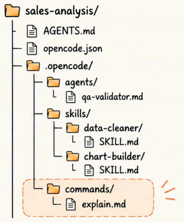
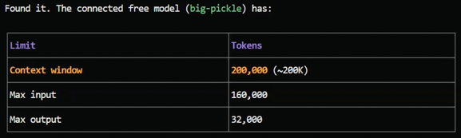
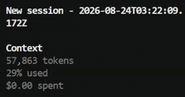
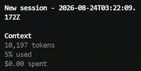
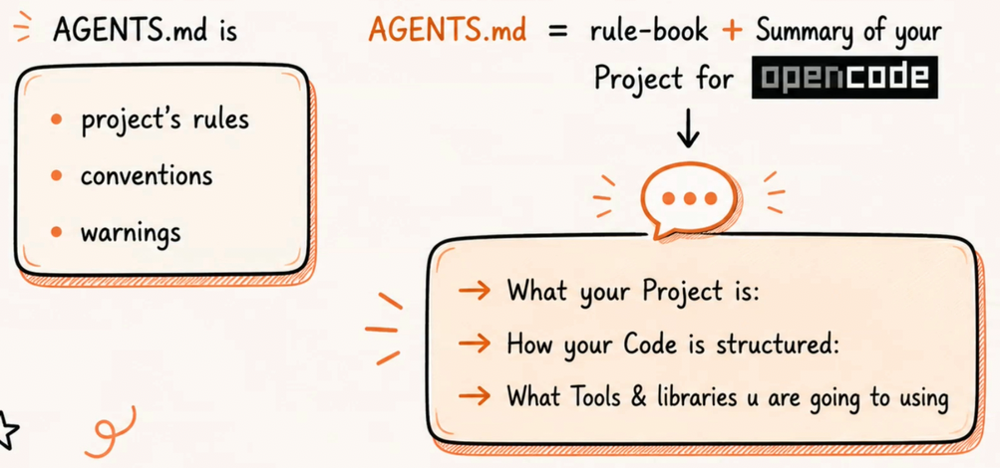
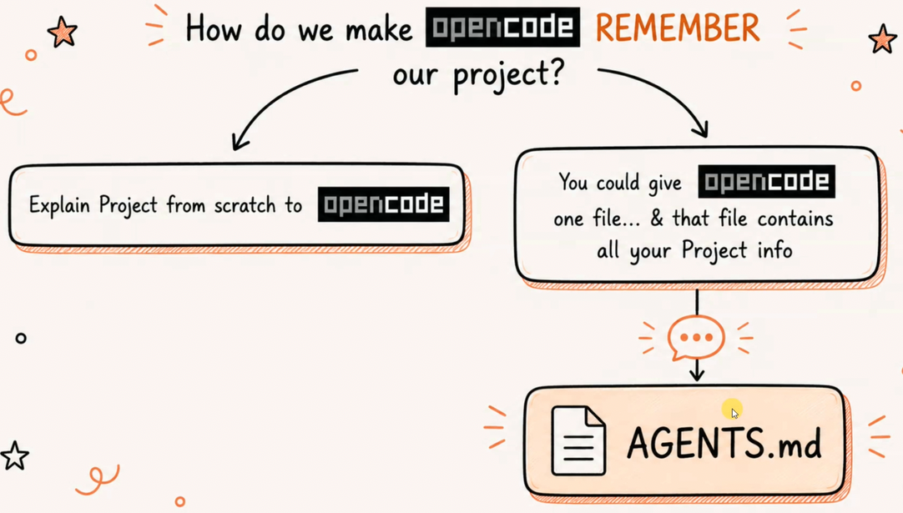
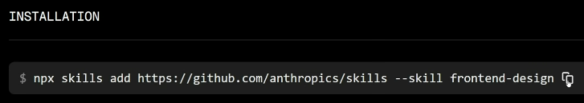
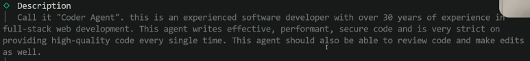
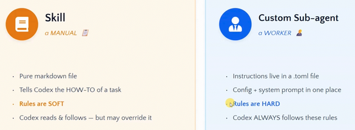
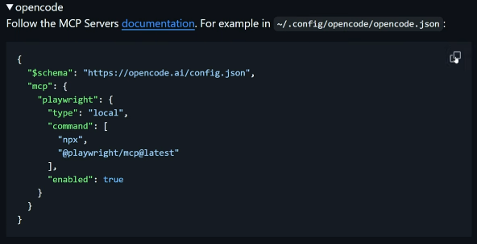

# OpenCode Basics
* [Youtube Link: OpenCode Tutorial for Beginners: Setup, Agents, Skills & MCP](https://www.youtube.com/watch?v=uZGDO0L-Dr4)

---

## Table of Contents
* [Introduction Usage](#introduction-usage)
* [Slash Commands](#slash-commands)
* [Context Window](#context-window)
* [What is AGENTS.md?](#what-is-agentsmd)
* [Skills](#skills)
* [Create Sub-Agents](#create-sub-agents)
* [Skills vs Custom-Agents](#skills-vs-custom-agents)
* [MCP](#mcp)

---

## Introduction Usage
* `opencode` - run this command in vs code terminal on your project folder.
* `/connect` - to connect to an ai provider.
* `/models` - to choose an ai model from the provider that you selected.
* `/variants` - to switch model variant.
* `esc` - to interrupt the agent.
* `/new` - to create a new session.
* `/sessions` - to continue a previous session.
* `shift + tab` - switch between **plan** mode and **build** mode. You may need to set what model will be used on different modes.

---

## Slash Commands

### Built-In Slash Commands
* Just hit `/` to show the built-in commands and their description.

### Custom Slash Commands

---

## Context Window
* The amount of information an AI can **SEE + REMEMBER** at one time.
* You can ask opencode. Example: "tell me the context window of this connected free model"

### Compact Command
* `/compact` to compact the session and to avoid the ai model from hallucinating.
* Example:
    - Before compact command:
    
    
    
    - After compact command:

    

---

## What is AGENTS.md?

* Scenario: You have a previous project. Opencode will not remember this because it only remembers what you discussed in a current session. 

* You could manually create this AGENT.md, or
* Use the `/init` command
* Note: It is preferred to manually create the AGENTS.md and put as little as possible, providing strict rules that the agent will follow.

---

## Skills
* You can search skills in https://www.skills.sh/
    - To install, copy the **npx** command:

    

    - paste it on terminal (project folder directory)
    - doesn't need to select anything on the list provided, just hit **Enter** to proceed the installation
    - you can choose **Project** or **Global** for the installation scope

* `/skills` - to verify that the agent has access to the installed skills. **Note:** If you don't see the newly installed skills, restart opencode by running `/exit` then `opencode`

---

## Create Sub-Agents
* `opencode agent create` - run this command on terminal on your project folder.
    - You can select if the custom agent is for current project only or for global.
    - Add description. Put here what the agent can do. Example:

    

* `/agents` - to select the native or created agents.

---

## Skills vs Custom-Agents
* When to use what?

---

## MCP
* To allow opencode to access to other tools.
* Example: Add playwright-mcp:
    - Go to https://github.com/microsoft/playwright-mcp
    - Install the Playwright MCP server with your client, copy this:

    

    - In the root of your project folder, create a file named: **opencode.json**
    - Paste it inside this file.
    - Open a new terminal window, run `opencode`, then `/mcp` to check if this new mcp is connected.
    - Hit `spacebar` if you want to disable it.
    - **Note:** If you don't see the newly installed mcp, restart opencode by running `/exit` then `opencode`
    - Then you can ask opencode to use it: "I need you to TEST the app and visually confirm that everything is working by using the playwright mcp tool."

---