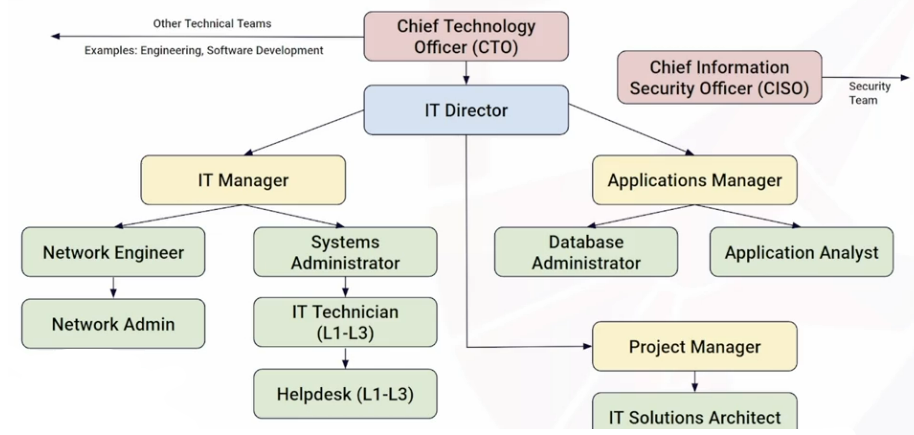
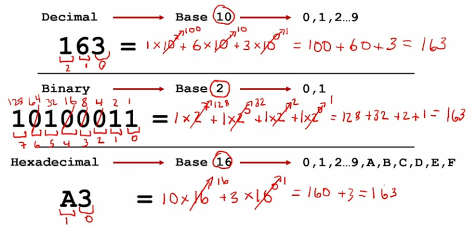
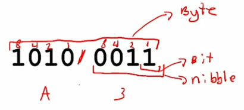
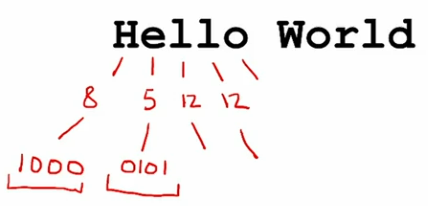
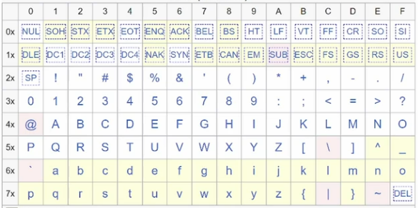
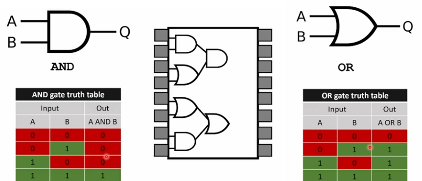
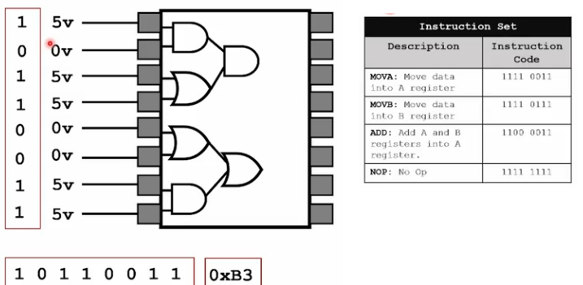
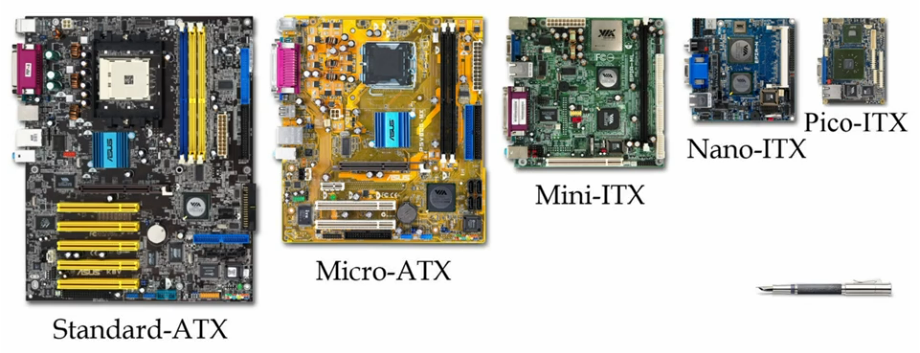
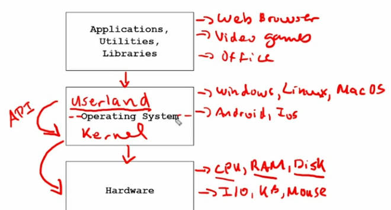

# Practical Help Desk Course
---
## Table of Contents
* [Intro to Information Technology](#intro-to-information-technology)
* [Intro to Computing](#intro-to-computing)
* [Computer Components and Repair](#computer-components-and-repair)
* [Operating Systems](#operating-systems)
---

 

## Intro to Information Technology

* **Information technology (IT)** is the use of computers, software, networks, and electronic devices to create, store, process, retrieve, and exchange data.

### IT Department
* Manages and supports the technology required for the organization to function.
* **IT Department Responsibilities** can vary between orgs.
    - Infrastructure Management
    - Tech Support
    - Security
    - Data Management
    - Identity and Access Management
    - Project Management
    - Compliance and Governance
* **Sample Org Chart**

* **Help Desk Responsibilities:** Individual contributor responsible for providing technical support and assistance to end-users, either within an organization or to customers.
    - Front line tech Support
    - Troubleshooting
    - Password and account management
    - Customer service
    - Escalation of support
    - Fixing or installing hardware
    - Installing and configuring software
    - Maintain and create documentation

 

---

 

## Intro to Computing

### The Binary System

### Bits and Bytes
* 4 bits = nibble
* 8 bits = 1 byte

### Encoding

* **ASCII**: American Standard Code for Information Interchange

* **UTF**: Unicode Transformation Format -- an extension of ASCII, so we can add emojis, etc.

### How a Computer Computes

#### Logic Gates
* By stacking them together we can have the logic gates perform basic computations.

* Each processor has what's called an instruction set. We can then store these instructions in some sort of external memory and have our processor run through them.

 

---

 

## Computer Components and Repair
* **Electro Static Discharge (ESD)**
    - just a small shock to humans but can be damaging to hardwares (computers). To prevent it is to use an **ESD mat** (made of rubber), or ground yourself by touching a large metallic surface.

* **Central Processing Unit (CPU)**
    - In desktop computers you're generally going to see one of two CPU manufacturers, it's either going to be **Intel or AMD**.
    - A **CPU core** is a physical hardware processing unit on a computer chip, while a **CPU thread** is a virtual or logical sequence of instructions that a core handles.

* **Random Access Memory (RAM)**
    - is the **temporary** memory that's used in the computer.
    - make sure that you put the right **DDR** that is compatible to your motherboard.

* **Drives**
    - An **HDD (Hard Disk Drive)** uses spinning magnetic platters and a mechanical arm to read and write data, like a tiny record player. An **SSD (Solid State Drive)** uses flash memory chips with no moving parts, working much like a giant USB thumb drive.

* **Power Supply Unit (PSU)**
    - **Wattage** measures the total power the PSU can deliver.
    - an **80 Plus Gold or Bronze rating** is usually the sweet spot for price and performance.

* **Graphical Processing Unit (GPU)**
    - VRAM (Video RAM): This is the GPU's dedicated memory.
    - 12GB to 16GB of VRAM is highly recommended for modern gaming.

* **Motherboard (MOBO)** 
    - it connects all your components and determines how much you can expand or upgrade your system in the future.
    - it is important to know the compatibilities of your components.
    - Form Factor (Size):

    

* **POSTing and the BIOS**
    - **POST (Power On Self Test)** - it's essentially a set of tests that the **BIOS (Basic Input Output System)**, or the firmware for the motherboard, runs when it powers on to make sure that everything in the computer is okay.

 

---

 

## Operating Systems
* **Abstraction**: The OS hides the complex, messy details of physical hardware and presents clean, simplified logical interfaces to applications and users.
* **Arbitration**: The OS manages, coordinates, and controls how finite hardware resources are shared among multiple competing programs, users, or devices.

### File Systems
* is a set of data structures, rules, and methods that an operating system uses to organize, store, name, and retrieve data on a **persistent storage** device (such as an HDD, SSD, or flash drive).

#### Common File System Types
* **NTFS:** The standard default file system for Microsoft Windows.
* **APFS:** The primary file system used by Apple macOS devices.
* **ext4:** The common default file system for Linux distributions.
* **exFAT:** A cross-platform file system ideal for flash drives and external drives shared between Windows and macOS.

### File Types / Extensions
- is a short suffix (usually 2 to 4 letters) at the end of a computer file name—separated by a period—that identifies the file's format and tells the operating system which program to use to open it.

 

---