# Practical Help Desk Course
---
## Table of Contents
* [Intro to Information Technology](#intro-to-information-technology)
* [Intro to Computing](#intro-to-computing)
* [Computer Components and Repair](#computer-components-and-repair)
* [Operating Systems](#operating-systems)
* [Virtualization](#virtualization)
* [Windows](#windows)
* [Linux](#linux)
* [Networking](#networking)
* [Remote Support](#remote-support)
* [Ticketing](#ticketing)
* [Security](#security)
* [Active Directory Lab](#active-directory-lab)

---

<br>

## Intro to Information Technology

* **Information technology (IT)** is the use of computers, software, networks, and electronic devices to create, store, process, retrieve, and exchange data.

### IT Department
* Manages and supports the technology required for the organization to function.
* **IT Department Responsibilities** can vary between orgs.
    - Infrastructure Management
    - Tech Support
    - Security
    - Data Management
    - Identity and Access Management
    - Project Management
    - Compliance and Governance
* **Sample Org Chart**

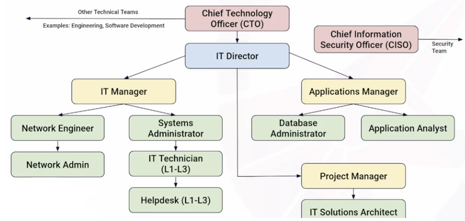

* **Help Desk Responsibilities:** Individual contributor responsible for providing technical support and assistance to end-users, either within an organization or to customers.
    - Front line tech Support
    - Troubleshooting
    - Password and account management
    - Customer service
    - Escalation of support
    - Fixing or installing hardware
    - Installing and configuring software
    - Maintain and create documentation

<br>

---

<br>

## Intro to Computing

### The Binary System


### Bits and Bytes
* 4 bits = nibble
* 8 bits = 1 byte

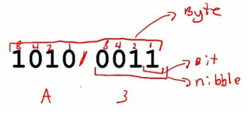

### Encoding


* **ASCII**: American Standard Code for Information Interchange

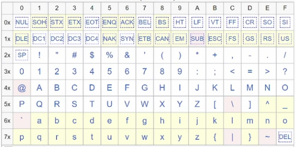

* **UTF**: Unicode Transformation Format -- an extension of ASCII, so we can add emojis, etc.

### How a Computer Computes

#### Logic Gates
* By stacking them together we can have the logic gates perform basic computations.

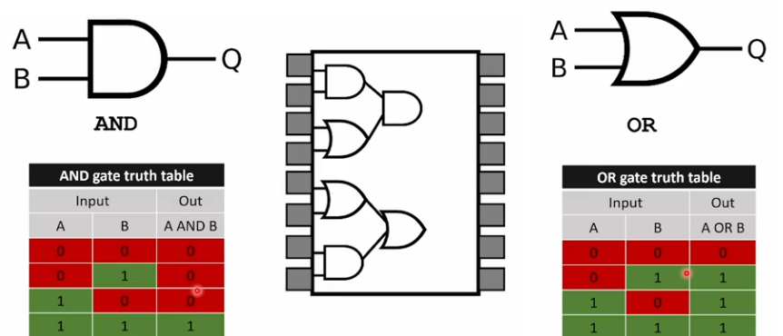

* Each processor has what's called an instruction set. We can then store these instructions in some sort of external memory and have our processor run through them.

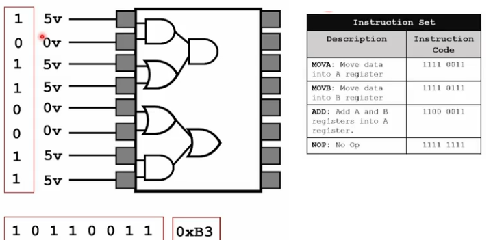

<br>

---

<br>

## Computer Components and Repair
* **Electro Static Discharge (ESD)**
    - just a small shock to humans but can be damaging to hardwares (computers). To prevent it is to use an **ESD mat** (made of rubber), or ground yourself by touching a large metallic surface.

* **Central Processing Unit (CPU)**
    - In desktop computers you're generally going to see one of two CPU manufacturers, it's either going to be **Intel or AMD**.
    - A **CPU core** is a physical hardware processing unit on a computer chip, while a **CPU thread** is a virtual or logical sequence of instructions that a core handles.

* **Random Access Memory (RAM)**
    - is the **temporary** memory that's used in the computer.
    - make sure that you put the right **DDR** that is compatible to your motherboard.

* **Drives**
    - An **HDD (Hard Disk Drive)** uses spinning magnetic platters and a mechanical arm to read and write data, like a tiny record player. An **SSD (Solid State Drive)** uses flash memory chips with no moving parts, working much like a giant USB thumb drive.

* **Power Supply Unit (PSU)**
    - **Wattage** measures the total power the PSU can deliver.
    - an **80 Plus Gold or Bronze rating** is usually the sweet spot for price and performance.

* **Graphical Processing Unit (GPU)**
    - VRAM (Video RAM): This is the GPU's dedicated memory.
    - 12GB to 16GB of VRAM is highly recommended for modern gaming.

* **Motherboard (MOBO)** 
    - it connects all your components and determines how much you can expand or upgrade your system in the future.
    - it is important to know the compatibilities of your components.
    - Form Factor (Size):

    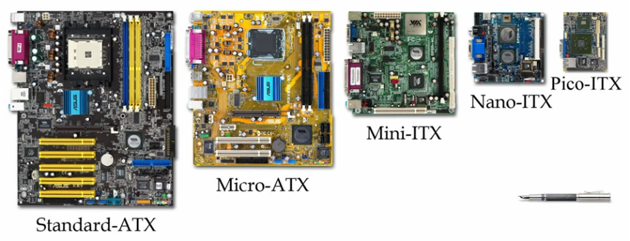

* **POSTing and the BIOS**
    - **POST (Power On Self Test)** - it's essentially a set of tests that the **BIOS (Basic Input Output System)**, or the firmware for the motherboard, runs when it powers on to make sure that everything in the computer is okay.

<br>

---

<br>

## Operating Systems
* **Abstraction**: The OS hides the complex, messy details of physical hardware and presents clean, simplified logical interfaces to applications and users.
* **Arbitration**: The OS manages, coordinates, and controls how finite hardware resources are shared among multiple competing programs, users, or devices.

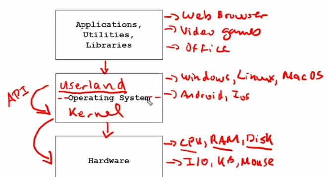

### File Systems
* is a set of data structures, rules, and methods that an operating system uses to organize, store, name, and retrieve data on a **persistent storage** device (such as an HDD, SSD, or flash drive).

#### Common File System Types
* **NTFS:** The standard default file system for Microsoft Windows.
* **APFS:** The primary file system used by Apple macOS devices.
* **ext4:** The common default file system for Linux distributions.
* **exFAT:** A cross-platform file system ideal for flash drives and external drives shared between Windows and macOS.

### File Types / Extensions
- is a short suffix (usually 2 to 4 letters) at the end of a computer file name—separated by a period—that identifies the file's format and tells the operating system which program to use to open it.

<br>

---

<br>

## Virtualization
We will virtualize an entire computer, which are often referred to as **virtual machines (VM)**.

### Hypervisor
Its responsibility is to partition up and allocate out the resources to the virtual machines.

- **Type 1**: is directly installed on the bare metal. It is more efficient than Type 2 because we're **not wasting any resources to run a base OS**.

    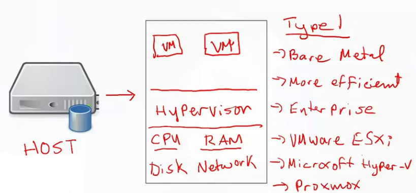

- **Type 2**: is for personal use only. It is installed on top of a base OS.

    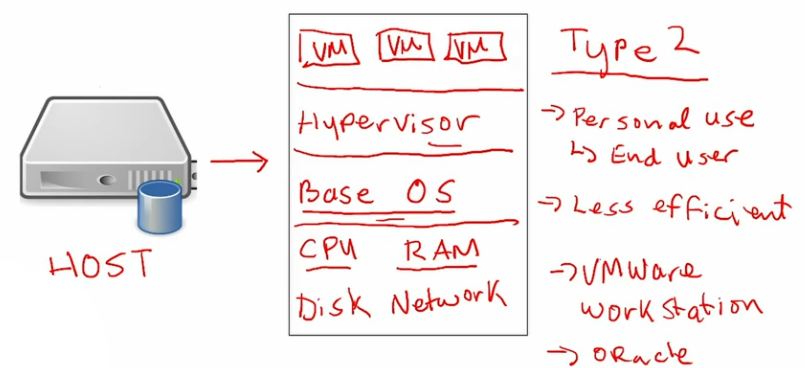

### Containers
The main difference between a container and a virtual machine is that **a virtual machine is intended to virtualize an entire computer**, where a **container is intended to virtualize just a single application**. And inside of that container, we only contain the things that are needed to actually run that application.

<br>

---

<br>

## Windows

### Local and Domain Accounts

#### Local Accounts
* exists and is managed on a single, specific machine.

#### Domain Accounts
* is stored centrally on a network server (such as Active Directory) and works across multiple computers joined to that domain.

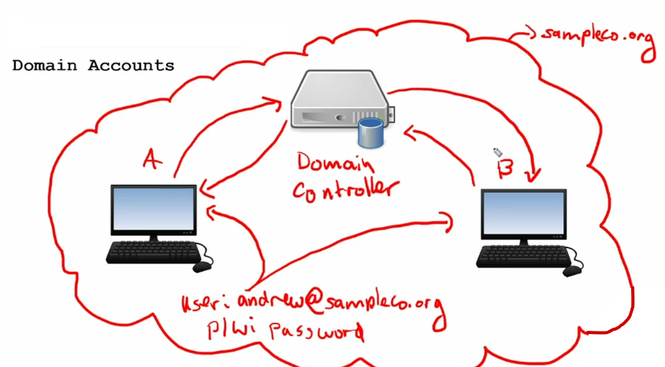

<br>

### Administering Local User Accounts

* Go to **Settings -> Accounts** 
* or **Control Panel -> User Accounts -> User Accounts**
* or **run -> lusrmgr.msc**

#### Users

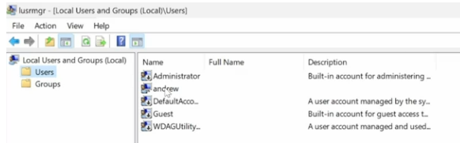

- **Administrator:** by default, this account actually gets disabled after Windows installs itself
- **andrew:** Windows actually sets the user account that we create first as an administrative account (in this example it was andrew)
- **Properties**: Double-clicking these users shows their **Properties**
    - General tab: You can do some password related options here.
    - MemberOf tab: You can see and add the group/s where this user belongs to.
- **New User**: you can right-click here and choose a **New User**

#### Groups

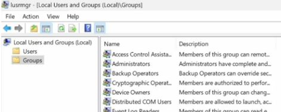

* There are groups here that have certain sets of permissions for specific tasks, and then just add our users to those groups.

<br>

### Local File Permissions

#### Folder Permission

* Note: In Windows by default when we create folders they're going to inherit the properties of their parent (ex. C: drive) and same with if we add any files to those folders. To disable this, click the **Advanced** button to **Disable Inheritance** -> **Remove all inherited permissions from this object.** -> **Apply**

1. Right-click the folder -> Properties.
2. Go to Security tab.
3. To change the permissions on a group, click **Edit**.

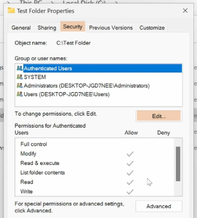

4. Or add or remove users/groups for this folder.

<br>

### Windows Logs and Event Viewer
* Start Menu -> then type `Event Viewer`
* **Critical** and **Error** are going to be probably the most important ones that we will want to take a look at.
    - Click the `+` then double-click the event to see more details about it.

    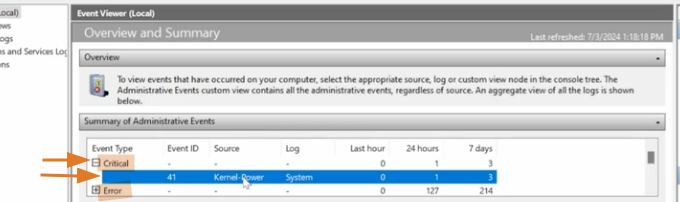

* **Windows Logs**
    - You can filter these logs if you're looking for something in particular.

    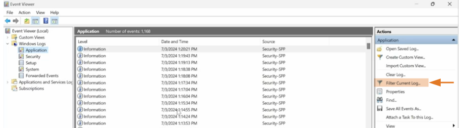

<br>

### Device Manager
* Start Menu -> then type `Device Manager`
* Example task: Add a printer that is accessible from the network:
    - In Device Manager -> Action tab -> **Devices and Printers**
    - Click the **Add a printer** (located beside the 'Add a device')
    - Double-click the detected printer that you want to add. 

<br>

### Windows Services
* We access it thru Task Manager -> Services tab -> `Open Services`
* or Start Menu -> then type `Services`
* **Windows Services** is a program that runs in the background and it operates without any user interaction or having a user interface.
* Sometimes developers will want certain processes or applications to just automatically run that don't need user interaction to take care of their task.
* Can set a task to run automatically, or manually, or start or stop it, etc.

<br>

### Windows Registry
* Start Menu -> Registry Editor
* The **registry** is actually just **a database that stores configuration settings for the operating system and applications that are installed**.
* A lot of settings in Windows and applications actually have user interfaces that allow us to easily make changes to the configuration of the application.
* It is organized by **KEYS** (that has subkeys) and **VALUES**.

<br>

### Windows Cmd Prompt
* Start Menu -> `cmd`
* **Batch scripting**: is the scripting language that Windows cmd uses.
* Some common commands:
    - `dir`: lists the content of the current directory
    - `cls`: clear screen
    - `cd`: change directory
    - `ipconfig`: shows your network configuration
    - `/?`: shows the help menu of a command. Example: `ipconfig /?`
    - `/` or `-`: adds options to a command. Eaxmple: `ipconfig /all`, `ping -n 12 8.8.8.8`
    - `ctrl + C`: halts an operation or a command
* If you open cmd as a standard user only you won't be able to access some files/directories due to permissions, even if your current user has admin priviledges. **Run as administrator** so that you'll have admin priviledges in cmd.

<br>

### Windows Task Scheduler
* Start Menu -> `Task Scheduler`

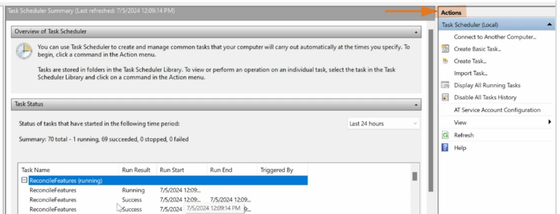

* On the right side panel you can see the **Actions** that you can do, like **Create Task...**
* You can add new tasks to automate like Disk Clean Up, etc.

<br>

---

<br>

## Linux

### GNU/Linux and Distros
* **Kernel** is responsible for **interfacing between the hardware and the applications** and software that actually run on top of it.

* **Full operating system** need the things like the applications, the software, the file system, and some sort of desktop user interface **that runs on top of the kernel**.

* **Linux** is only the kernel of the operating system. The **GNU** accounts for the other parts of the OS, like the applications and file system that **run on top of the kernel** to make it a complete OS.

* **Distros** are different variations of Linux. A Linux distro is generally made up of:
    - **Linux kernel**
    - **Packages** which are the software or application that run on top of it
    - **Package Manager** which is used to install, update, or otherwise manage the packages
    - **Desktop UI** so that users can interact with it.
        - Gnome


<br>

### Linux Filesystem Hierarchy

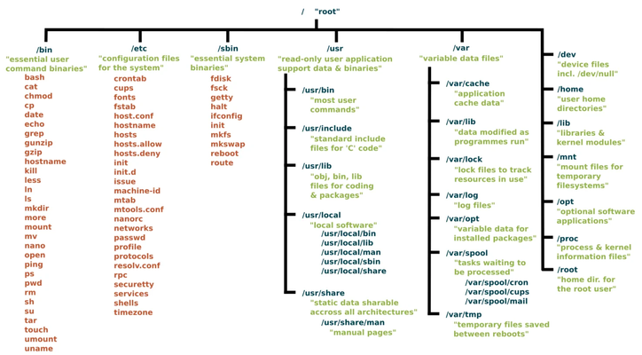

* **bin**: short for *binaries*, this folder contains the majority of the binaries or as they're sometimes referred
to **executables commands**.

* **sbin**: short for *system binaries*, these are binaries that are only expected **to be used by the root or super user**.

* **lib**; short for *libraries*, this contains all of the libraries that those binaries are going to make use of (these are the dependencies or external code that those binaries require)

* **usr**: these are user files or executables that are not required for the operation of the operating system itself but are to be used by the end user.

* **etc**: short for *editable text configuration*, this conatin files to configure the various binaries and even things in the operating system.

* **home**: this has the users' home directories, which contains the user's config files, etc.

* **dev**: this contain files that represent devices.

* **boot**: this contain all the required files of linux to boot up.

* **opt**: this is designed to be a folder where we could install optional softwares

* **tmp**: this is where both the OS or user can write temporary files, which does not persist after a reboot.

* **var**: short for *variables*,this folder is going to store variables that the operating system needs while it's in use.

* **proc**: short for *process*, what it is for is actually for the OS to keep track of all of the processes that are running so that's why you'll see a bunch of numbers.

<br>

### Linux File Permissions

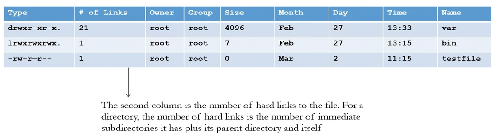

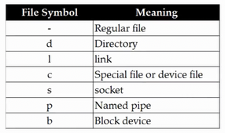

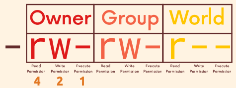

### Common Commands

#### `adduser`
- to add a new user
- Example: `sudo adduser jayson`

#### `addgroup`
- to create a new group
- Example: `sudo addgroup confidential`

#### `usermod`
- to add a user to a group
- Example: `sudo usermod -a -G confidential jayson`

#### `passwd`
- to change or expire the password
- Example: `sudo passwd --expire jayson` to make jayson's password expire and will require him to give a new one

#### `chmod`
* to change file permission 
* Example: `sudo chmod 700 test.txt` means that the **owner** will have all the permissions on the file (read, write, execute) (4 + 2 + 1), while the **group** and **world** has none (0 + 0 + 0), resulting to `-rwx------`

#### `chown`
* to change the owner of the file
* Example: `sudo chown root test.txt`

#### `chgrp`
* to change the group of the file
* Example: `sudo chgrp root test.txt`

#### Note: Directories are generally executable

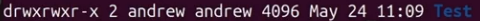

<br>

### Scheduling Tasks with Cronjobs
* `crontab -l`: to list all the cronjobs of the current user 
* `crontab -e`: to edit the cron config file of the current user

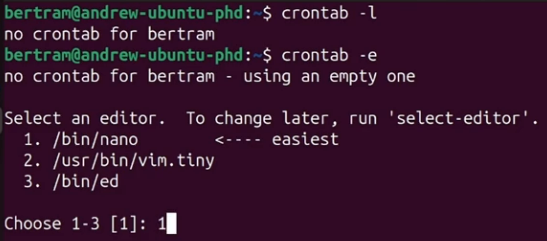

#### Cron Syntax


#### Cron Characters

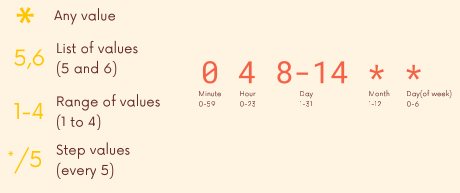

#### Cron examples:

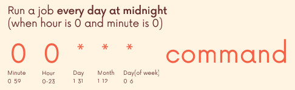

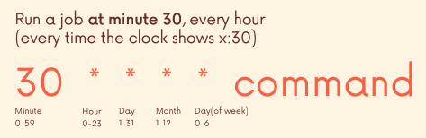

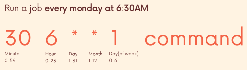

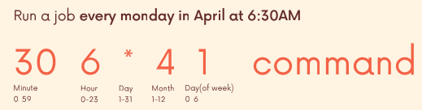

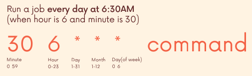

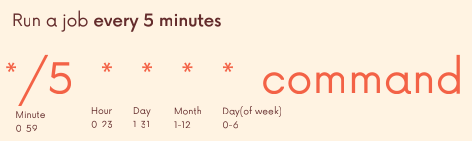


#### Run a cronjob as root for another user
* while logged in on your target user, run: `sudo crontab -u root -e`


<br>

### Upgrading and Installing Packages (also known as softwares)

* `sudo apt update`
    - **apt** is the package manager for debian and debian-based distros 
    - **dnf** is the standard package manager for Fedora, Red Hat Enterprise Linux (RHEL), Rocky Linux, and AlmaLinux
    - does not install or upgrade any software. It only refreshes your computer's local list of available packages and versions from the internet.

* `sudo apt upgrade`
    - installs the newer versions of the software you already have installed, based on that refreshed catalog. If an update requires removing something else, it skips it.

* `sudo apt full-upgrade`
    - performs a complete system upgrade. Like a standard upgrade, it installs new versions, but **it is smart enough to handle complex changes**.

* `sudo apt install <software name>`
    - used to install a new software that should be available from that package.

* `sudo apt remove <software name>`
    - used to uninstall a software.

<br>

---

<br>

## Networking

### Intro to Networking

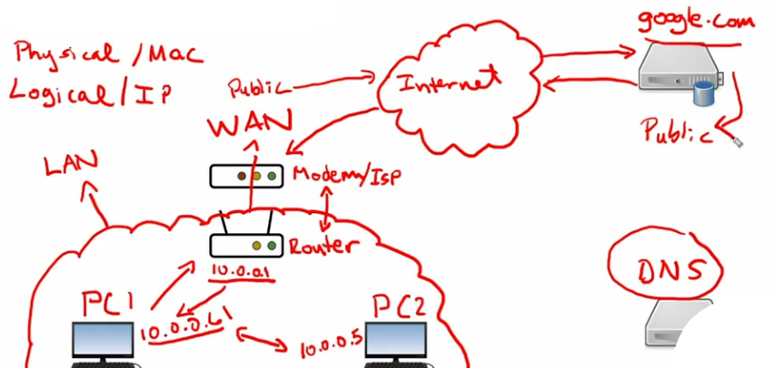

* `ipconfig`: a Windows command to view all IP addresses and interfaces.
* `ip a` or `ifconfig`: a Linux command to view all IP addresses and interfaces.

#### Private IP Addresses
* 10.0.0.0 - 10.255.255.255 - usually used on commercial local networks
* 172.16.0.0 - 172.31.255.255
* 192.168.0.0 - 192.168.255.255 - usually used on home networks

#### DNS Look Up
* `nslookup`: a linux/windows command to see the public ip address/es of a domain name. Example: `nslookup www.google.com`

<br>

### The OSI Model 
* OSI stands for **Open Systems Interconnection**
* Not a protocol itself, more of a guide
* Useful for communication between IT professionals and
troubleshooting (shared understanding of complex system)

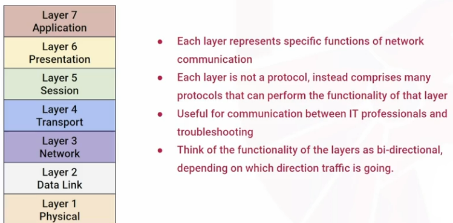

#### Layer 1: Physical
* Refers to the **actual signals** being used to transmit the data
* Voltage (bits on the wire), Light, Radio Frequency (RF)
* Layer 1 issues include **unplugged/damaged cable** or connectors or **weak wireless signal**


#### Layer 2: Data Link
* Transmit data directly **between two devices**
* Sometimes referred to as the **switching layer**
* Data Unit: **Frame**
* This layer is responsible for getting frames (the data) between two devices
* **Performs collision detection and prevention**
* Uses **MAC addresses** to communicate
* Networking Eguipment: **NIC** and **Switch**

#### Layer 3: Network
* Responsible for **getting data throughout a network(s)** from one destination to another
* Networking layer addresses **segments of data with IP addresses to create a packet**
* Responsible for **actual routing of data** through the network
* Determining **best path** (routing) for data.
* Data Unit: **packet**
* Uses **IP addresses**.
* Networking eguipment: **Router** and **NIC**

#### Layer 4: Transport
* Responsible for **breaking data streams down into segments** that can be transmitted
* Handles **flow control** so data is not sent too fast (or too slow)
* Performs **error checking via a checksum to receiver** can verify segment integrity
* Data unit: **Segment**
* Uses **UDP** or **TCP**
    - UDP (User Datagram Protocol): 
        - Connectionless protocol that **doesn't use acknowledgements**
        - Sends traffic out and doesn't care if receiver gets it (**faster**)
        - **Good for time-sensitive applications like gaming or streaming**
    - TCP (Transmission Control Protocol):
        - Connection based protocol that **checks data if received**
        - Uses a **3-way handshake** to acknowledge data is received correctly
        - Is **slower** than UDP but **better suited when integrity is important**, like **downloading a file**

#### Layer 5: Session
* Responsible for **creating and managing separate communication channels between devices aka sessions**
* When communicating with a server **multiple sessions may be opened** to receive files in parallel
* Can be used to **resume interrupted communication**
* Handled by the **web browser**

#### Layer 6: Presentation
* Responsible for **translating data between human readable formats and computer readable**
* Performs **compression**
* Responsible for **encryption of data**
* Also handled by **web browser** 

#### Layer 7: Application
* Comprised of the protocols that we interact with or the **“applications” we use interact with HTTP, POP3, SSH, Telnet**
* If you're interacting with it or see it on your screen it's most likely layer 7
* Also handled by the **web browser**

<br>

### Network Addresses and Subnet Masks
* We can have addresses in the range of anything **from 0.0.0.0** all the way up **to 255.255.255.255**  -- there are sets of IP addresses inside of this range that are reserved for specific things:
    - **Network Address**: the first IP address. Example: **192.168.50.0**
    - **Default Gateway**: the IP address of the Router. Example: **192.168.50.1**
    - **Broadcast Address**: the last IP address. Example: **192.168.50.255**
    - **Subnet Mask**: tells us which portion of the IP address is actually for the network address and then which portion of that IP address are free to be used for the host address.
    
    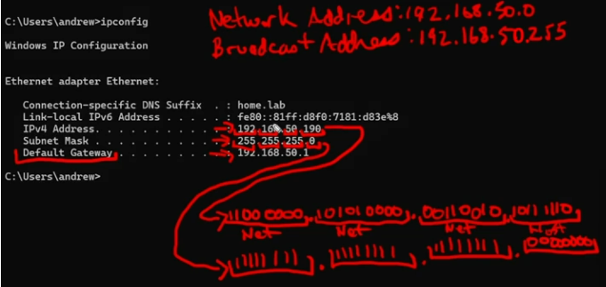

    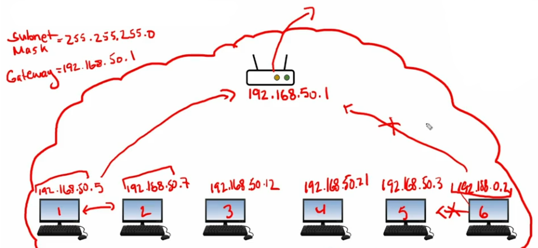

<br>

### CIDR Notation
* CIDR = **Classless Interdomain Routing**
* CIDR Notation = Shorthand to write out IP and Subnet Mask
* Examples:

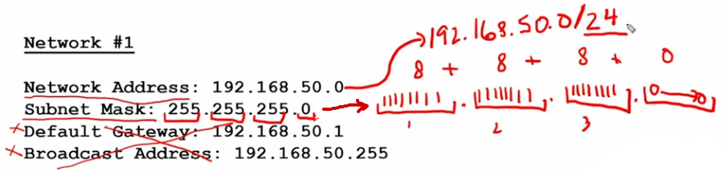

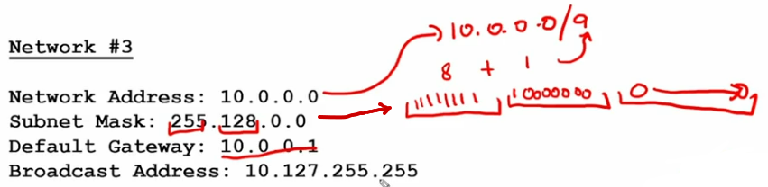

**Note:** A valid Subnet Mask should have 0s all the way to the end (contiguous)

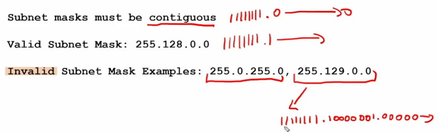

<br>

### Hubs, Switches and ARP

#### Hubs
* Hubs are obsolete because when a hub receives a data packet on one port, it blindly broadcasts that data out to every other port and connected device.

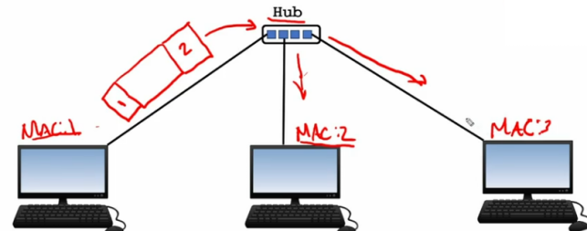

#### Crossover Cable
* For connecting just 2 devices.

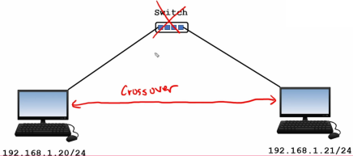

#### Switch

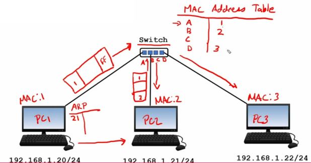

* **Unamanaged Swicth**: All ports are identical.

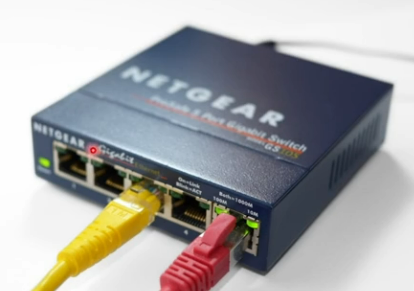

* **Managed Switch**: Allows us to perform some **configuration like VLAN**. You'll also be able to set things like **mirroring ports**.

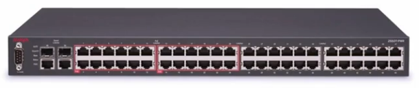


#### ARP
* ARP (Address Resolution Protocol) is the digital translator that **connects an IP address to a MAC address** (physical device)
* `arp -a`: is a linux/windows command to see the **arp table**

<br>

### Routers
* **Switches** are used to create networks and **routers** are used to connect networks together.

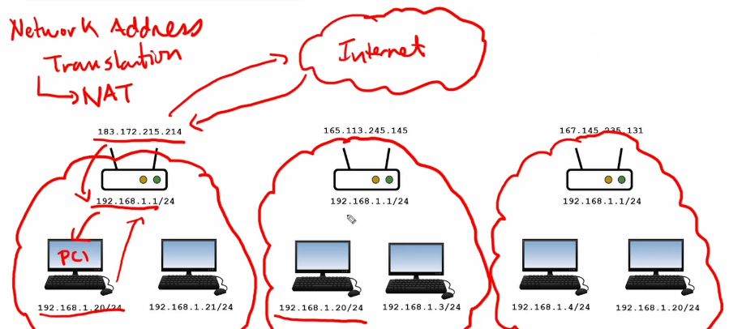

<br>

### Ports
*  A **port** is a **virtual slot** used by an operating system **to direct network traffic to specific applications or services**.
* **Firewalls** use ports to block or allow data, securing your device from unwanted access.
* Common Examples:

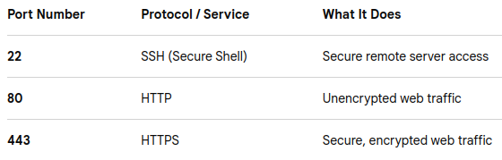

- **Note:** For web servers, they usually open port 443 to listen for incoming requests from the user.

- **Note:** We can have ports for both TCP and UDP and those are separate ports apart from each other.

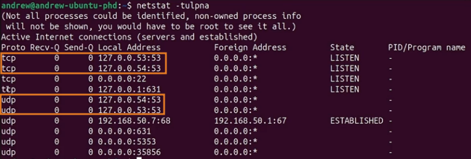

- **Notes:**
    - `netstat -tulpna`: a linux command to see the open ports in your machine.
    - `127.0.0.*` - local host (loop back addresses), which doesn't listen from extenal connections.
    - `0.0.0.0` - means that we're listening on all IPv4 addresses
    - `192.168.50.7:68` - this is an example of an ESTABLISHED coonection to the router (192.168.50.1:67) - and these ports **67 and 68 are associated with DHCP** - the basics of this protocol is that it is what allows us to get an IP address from the router.

<br>

### VPN (Virtual Private Networks)
* Used to create an encrypted channel (usually) over the internet between a client and server
* Multiple use cases
* Connect to another LAN through the internet
* Additional security for traffic over the internet
* Increased anonymity on the internet

#### Remote LAN Connection
* Used to allow a remote computer to tunnel into a LAN through the VPN server
* Frequently used to allow remote workers to access an office LAN and internal resources
* VPN client device will receive a LAN IP of the remote network
* For the most part the client can communicate as if it were physically on the LAN
* Traffic still encrypted over the internet, even if LAN

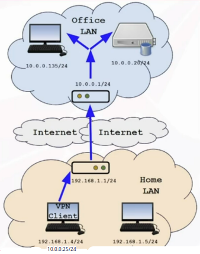

<br>

### OpenVPN Client (Plus how to connect to TCM Exam Platform)

#### Windows Setup
1. Go to https //openvpn.net/client/
2. Click **Download OpenVPN Connect for Windows**
3. Install.
4. Download the `.ovpn` file from https //exams.tcmsecurity.com

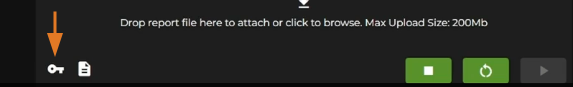

5. Upload file on OpenVPN app.

#### Linux CLI
1. Download the `.ovpn` file from https //exams.tcmsecurity.com
2. Go to the folder where you downloaded the file.
3. `sudo openvpn --config <ovpn file>`

<br>

### Network Troubleshooting Commands (Windows)

* Start Menu -> Command Prompt (Run as Administrator)

* `ping <ip address or url>`: to check if you have a connection to the specified ip address. Good for checking **layer 3** network connections. Example: `ping 192.168.50.1`, or `ping www.google.com`
    - Note: One thing to keep in mind is that some devices actually will be configured to not respond to ping messages by default for security issues.

* `ipconfig`: to see both our IP address, the subnet mask and the default gateway.
    - `ipconfig /all`: to see more details like the mac address, etc.
    - `ipconfig /release`: sometimes releasing your current ip address and getting a new one can fix some networking issues on our network. Then run `ipconfig /renew` to have a new ip address.
    - `ipconfig /displaydns`: to get a bunch of details back for the various DNS records we have.
    - `ipconfig /flushdns`: to flush the DNS Resolver Cache. Then run `ipconfig /registerdns` to get a fresh register of DNS.
    - `ipconfig --help`: to see more ipconfig options

* `tracert <ip address or url>`: the way it works is every time it gets öne hop, it then sends a message asking for it to do another hop until it reaches its final destination. Example: `tracert www.google.com`

* `netstat`: useful for troubleshooting if we want to make
sure that connections are actually being open for the applications that we want them to do.

* `arp -a`: allows us to interact with and see the ARP table that's on our computer.
    - `arp --help`: to see other arp options
    - `arp -d <ip address>`: to delete a single ip in the arp table
    - `arp -d *`: to delete all the ip in the arp list

* Start Menu -> Control Panel -> Network and Internet -> Network and Sharing Center -> Change adapter settings: to see if your network is connected, check some settings, etc.

<br>

---

<br>

## Remote Support 

### SSH (Secure Shell)

#### SSH to a Configured Server

* To create an SSH Server in Linux (example: in Ubuntu)
    - `sudo apt install openssh-server`
    - `sudo systemctl enable ssh`
    - `sudo systemctl start ssh`
    - `systemctl status ssh` - to check if it's active and to see what ip & port it is listening, in this example: **Server listening on 0.0.0.0 port 22**, hit `q` to exit.
    - `sudo ufw allow ssh` then check its status, enable it if it's inactive:

    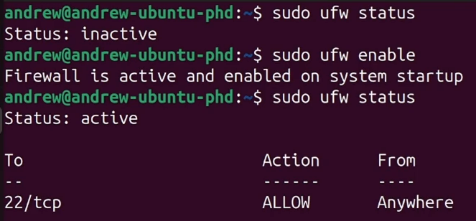

    - `ip -a` to see your ip address. Example:

    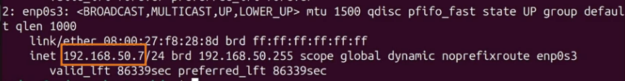

    (Note: Make sure that Network Settings in your VM is set to **Bridged Adpapter**)

* Go to Windows 11 (ssh is pre-installed in Windows 11):
    - Start Menu -> Command Prompt (Run as Admin)
    - `ssh <username@ipaddress>`. Example: `ssh andrew@192.168.50.7`
    - Enter andrew's password


#### SSH using Key Pairs
* Go to Windows Command Prompt
    - `ssh-keygen`
    - just hit `Enter` if you accept the default file location
    - Enter passphrase for added security, or hit `Enter` if you don't want to add a passphrase
    - cd to the key location to check:

    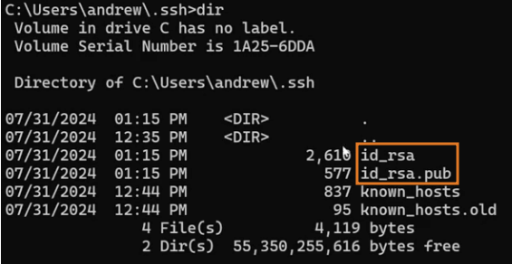

    - **Important Note:** `id_rsa` is the **private** key, and should NOT be handed over to anyone. The `id_rsa.pub` is the public key that we will give to our Linux machine.
    - Copy the Windows public key to andrew's ssh folder (~/.ssh) by using `nano authorized_keys` then paste it here.
    
    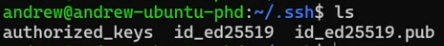

    - Now you can ssh to andrew without a password.

<br>

### Remote Desktop (RDP)

* Go to Windows 11:
    - Start Menu -> System
    - Click **Remote Desktop** then toggle it ON. Take note of your PC-name.

    

    - Click the **Remote Desktop users** only if you want to set up what users actually have access to the Remote Desktop.
    - In Windows Command Prompt, run `ipconfig` just to see your ip address. In this example, `192.168.50.190`.

* Go to Linux VM (example: Ubuntu):
    - `sudo apt install remmina`
    - Go to your apps to launch **Remmina**, input the Windows 11 ip address:

    

    - Input andrew's username and password. Click Okay.

* Connect from Windows to Windows
    - On another Windows PC, hit **Windows + R** then run `mstsc`
    - Input andrew's username and password. Click Okay.

<br>

### VNC (Virtual Network Computing)

* Go to Windows 11 to setup VNC server:
    - Download a third-party software **TightVNC** at https://www.tightvnc.com/download.php then Install it.
    - For security, set up the password:

    

    - VNC server will run automatically on the background.

* Go to your Linux VM (example: Ubuntu):
    - Go to your apps to launch **Remmina**, change the protocol to **VNC** then input the Windows 11 ip address.
    - Input the password that you setup earlier.

<br>

---

<br>

## Ticketing

### Installing Docker and Peppermint
* Go to your Linux VM and install docker. You can follow this: https://docs.docker.com/engine/install/ubuntu
* To test if your installation was successful, run `sudo docker run hello-world` 
* Go to https://github.com/Peppermint-Lab/peppermint
* Copy **Installation with docker**.
* Go to your terminal and create a docker-compose file inside a new directory. Example:


* Paste here and adjust `API_URL: "http://localhost:5003"`
* Run `sudo docker compose up`
* Go to your web browser. `http://localhost:3000`
* Sign in using email: `admin@admin.com`, password: `1234`
* Click **To Dashboard**
* When you're done using peppermint, run `sudo docker compose down`

<br>

### Configuring Peppermint
* Go to your peppermint directory, in this example **~/peppermint**
* Make sure first that it is down, `sudo docker compose down`
* Run `sudo docker compose up`
* Then sign in like before:
    - on web browser: `http://localhost:3000`
    - email address: `admin@admin.com`; password: `1234`; Click **To Dashboard**
* Add **Users**:
    - On the left side, click **Admin Settings** then click **Users**
    - Add 3 random users.
* **Clients** - clients means the people that are actually going to be putting in tickets to solicit support from IT dept
    - On the left, click **Clients**
    - Click the **New Client** button then add some random clients.
* **Email queues** - we can set up a list of mailboxes that we're listening to
* **Web Hook Settings** - these are to allow us to actually go out to various URLs and trigger things. Example: We could create web hooks to send us a slack message if we receive a new ticket.
* **Outbound Email Settings** - if we have an email host that we can configure, that would allow us to automatically
email out people.
* **SSO (Single Sign On) settings** - So then we could actually have people sign on with their SSO from the organization.

<br>

### Creating, Commenting, Assigning and Closing Tickets
* In peppermint, sign in as a normal user with no admin rights (the one that you created earlier)
* On the left side, click **Create Ticket**.
* Simulate creating a new ticket, you can assign it to another user (technician) that you created earlier, but for this example just assign it to yourself:


* Since we assigned it to ourselves, we can now see that we have a pending open ticket.


* Just pretend that we took care of this issue, comment what you did, then close the ticket. After clicking the **Close Ticket**, the button will change to **Reopen Issue** if we need to reopen this issue.


<br>

---

<br>

## Security

### The CIA Triad
* CIA stands for **Confidentiality Integrity Availability**

#### Confidentiality
- Keeps sensitive data private and hidden from unauthorized users. Measures include **data encryption, multi-factor authentication (MFA)**, and **strict access controls**.

#### Integrity
- Ensures data is accurate, trustworthy, and free from unauthorized tampering or corruption. Common tools include **digital signatures, cryptographic hashing**, and **checksums**.

#### Availability
- Guarantees that authorized users can reliably access systems and data whenever needed. This is supported by s**ystem backups, hardware redundancy**, and **disaster recovery plans**.

<br>

### Firewall, AV, EDR and SIEM

#### Firewall 
- A digital barrier that **monitors and filters incoming and outgoing network traffic based on established security rules**. Think of it as a security guard at the gate of your network, deciding who is allowed to enter and leave.

#### AV (Antivirus)
- Software **designed to detect, block, and remove known malicious code (malware) like viruses, worms, and trojans**. It relies primarily on a library of "signatures" (like digital fingerprints) to recognize traditional cyber threats.

#### EDR (Endpoint Detection & Response)
- An advanced security tool that **continuously monitors individual devices (endpoints like laptops, desktops, and servers)** for suspicious behavior. Unlike a standard AV, EDR **doesn't just look for known signatures; it tracks live activity** to spot novel, fileless, or active hacker behaviors and allows teams to isolate the device instantly.

#### SIEM (Security Information & Event Management)
- A **centralized platform that aggregates and analyzes log data from across an entire organization**. It acts as the **brain or "control room"** of security operations, gathering data from your Firewalls, EDRs, servers, and networks to cross-reference activities, spot complex attacks, and generate alerts.

<br>

### TAM, SSO and MFA

These three concepts focus heavily on **Identity and Access Management (IAM)**—ensuring the right people have the right access while keeping attackers out. You'll sometimes hear the important aspects of IAM referred to as the 4 A's (**Administration, Authentication, Authorization, and Auditing**)

#### TAM (Technical Account Manager)
- In cybersecurity contexts, a TAM **is a dedicated cybersecurity advisor provided by a technology vendor to partner with an organization**. They help companies properly configure, update, and optimize their complex security tools to prevent vulnerabilities before they happen. (Note: In broader IT, **TAM can also stand for Technology Asset Management**—tracking hardware and software devices).

#### SSO (Single Sign-On)
- An authentication method that **allows a user to log in once with a single set of credentials and gain access to multiple independent applications**. For example, when you log into your corporate portal once and instantly access your email, HR portal, and chat apps without entering your password every single time. It improves user convenience while making it easier for IT teams to manage and revoke access from a central point.

#### MFA (Multi-Factor Authentication)
- A security protocol that **requires users to provide two or more verification factors to gain access to an account**. Instead of just relying on a password (which can be stolen), MFA forces you to also provide something you have (like a physical token or a push notification on your smartphone) or something you are (like a fingerprint or face scan). **MFA is usually used for SSO**.

<br>

### Social Engineering
* It is the **act of manipulating someone to give up sensitive information or perform a task**.

* It **can take many forms** including phishing emails, over the phone or text message or even in person

#### Common Warning Signs 
- The use of a pretext, where an attacker creates a **false story and/or identity** to gain trust of the victim

- The attacker creates a **sense of urgency** that something needs to be done and possibly inserts **a consequence if the request isn't fulfilled quickly**

- The attacker is **making a request for something**

<br>

### Phishing
* Phishing is a type of social engineering.
* The most common is email phishing, however other formats like text and voice calls are used.
* Common goals of phishing include:
    - gathering passwords through fake login portals
    - getting users to click links to malicious websites
    - getting users to download malicious attachments
    - gathering confidential information
    - askyou to perform as task (like buying gift cards)

#### Other Types of Phishing
* **Smishing**: sms phishing aka phishing via text messages
* **Vishing**: voice phishing, a type of phishing usually performed over phone
* **Spear phishing**: targeted phishing attempts which use more detailed pretexts specific to their target
* **Whaling**: targeting high value accounts like C-Suite (CEO,
CISO, CFO etc.)
* **SEO Poisoning**: using sponsored or suggested posts to
direct users to illegitimate support lines or websites

<br>

---

<br>

## Active Directory Lab

### What is Active Directory (AD)
* AD is Microsoft's (very popular) directory service.
* AD contains details like:
    - Name
    - Email
    - Username
    - Password
    - What resources you can access
    - What computers you can login to
    - What you can do on those computers

#### Why Active Directory (AD)
* Centralized IAM for users and resources in an organization
* Ease of administration by having centralized source of truth
* Enhanced security, allows for much more granular controls of who can do and access what
* Single point for backup and recovery

#### Physical Components of AD
* **Domain Controller**
    - Server (physical, virtual, cloud in Azure)
    - Hosts AD Database
    - Responds to authentication requests
    - Process logins
    - orces policies
* **AD Database (NTDS.dit)**
    - Stores the data for the directory
    - Stores log files
    - Structure of the DB is called the Shema

#### Logical Components of AD
- Logical components of AD are what provide structure to how the environment is laid out
- They allow for organization and management of
users and resources
- In AD essentially everything inside of the database
is considered an object
- Some objects are also containers in that they can hold other objects, think of them like folders, this is what gives AD it’s hierarchical structure


#### Domain
- **One of the top level containers** is a domain
- Holds a collection of objects (users, computers, groups and more)
- Serves as an **administrative boundary for managing the objects** inside of it
- **Can enforce security and policy settings** across all objects inside the domain
- Domains are **referred to by their domain name in this example abc.com**
- Frequently this will line up with an organizations registered
domain

#### Organizational Units
- **A container object inside of domains**
- Used to group together other objects
- Lowest level container that can allow administrative privileges over it
- Lowest level container that can have group policies applied to it
- Frequently organizations will split up departments into OUs (Sales, HR, IT, Engineering etc)

#### Non-Container Objects
- Users
- Computers
- Groups (used for setting access)
- Printers
- Group Policy Objects

#### Forests and Trees


#### Active Directory Example


<br>

### Configuring Server as a Domain Controller
* Start Menu -> **View your PC name** -> **Rename thic PC** button -> name it "DC01" (example only) -> Restart now

* On the top right corner of the Server Manager Dashboard, click **Manage** -> Add Roles and Features
    - click Next
    - select **Role-based or feature-based installation**, click Next
    - Select the server that you just created: "DC01", click Next
    - put check on **Active Directory Domain Services** -> click **Add features** button, click Next
    - click Next a few times (the default checks are okay for now)
    - Put check on **Restart the destination server automatically if required** -> click Yes -> click **Install**
    - After Feature installation click **Promote this server to a domain controller**

    

    - select **Add a new forest**, then Root domain name: "LAB.local" (example only) -> click Next
    - Type the Directory Services Restore Mode password -> click Next -> Next again
    - wait for the "LAB" name to show up then click Next -> click Next again to accept the deafults location
    - if you get the green check that you passed the **Prereguisites Check**, click **Install**

    

    - After installation it will restart, you should see the "LAB\" on the log in screen.

    

* Click again **Manage** -> Add Roles and Features
    - click Next
    - select **Role-based or feature-based installation**, click Next
    - if "DC01.LAB.local" is already selected, click Next
    - put check on **Active Directory Certificate Services** -> click **Add features** button, click Next
    - click Next -> Next again -> Next again
    - Put check on **Restart the destination server automatically if required** -> click Yes -> click **Install**
    - After Feature installation click **Configure Active Directory Certificate Services on the destination server**

    

    - click Next, then put check on **Certification Authority**, click Next
    - leave the default selected **Enterprise CA**, click Next
    - leave the default selected **Root CA**, click Next
    - leave the default selected **Create a new private key**, click Next, click Next again a few times until you click **Configure** -> Close -> Close

<br>

### Creating Domain Users

#### Organizing Folders
* On the top right corner of the Server Manager Dashboard, click **Tools** -> **Active Directory Users and Computers**
* Right-click **LAB.local** -> **New** -> **Organizational Unit**


* Name it whatever you want. In this example: **Groups**
* Click **Users**, then select all the **Security Group** type (just leave the *User Type* - Administrator and Guest), then drag them inside the new folder that you just created, **Groups**. Just click Yes when a warning shows up.


#### Users Folder


* **Administrator**: 
    - This is not just the administrator of this computer, but it's also the **domain administrator**.
    - This is **a very powerful account** - it essentially **has control over the entire domain** or the keys to the whole castle.
    - One of the best practices is that **we actually shouldn't be logging in as a domain administrator** account unless we absolutely need to to be making changes that reguire those privileges.
    - **Member Of** tab - you'll see the different groups that they are part of.

    

* **Guest**:
    - The *down arrow* in its icon means it's not in use.

#### Creating Domain Users inside the Users Folder
* Right-click inside the Users folder -> **New** -> **Users**
* Name it whatever you want.


* Click Next to create Password, click Next, then Finish
* Create 3 more new users, by right-clicking this newly created user (in this example: Richard), then select **Copy...**, then repeat the process above.


<br>

### Attaching Windows 11 VM to Domain

#### Create a new Network in VirtualBox
* In VirtualBox, create a new Network for this lab: **File** -> **Tools** -> **Network Manager**
* Click **Create** (make sure that you are in the NAT Networks tab)
* Name it whatever you want (example: ADNetwork)
* Leave the others options in default, then click Apply.

#### Windows 11 and Server VM Settings
* Click your Windows 11 VM, then go to its Network settings
* Select the NAT network that you created earlier.
* Click your Windows Server VM, then go to its Network settings
* Select the same NAT network that you created earlier.
* Start both the VMs.

#### Windows Server Static IP Setup
* Open Command Prompt, run `ipconfig` to see your network settings.
* On the bottom right corner of your windows taskbar, click **Open Network and Internet settings**
* Click **Change adapter options**
* Right-click **LAB.local**, then click Properties
* Double-click **Internet Protocol Version 4**


* Copy the IP address from your Command Prompt, and localhost for the DNS Server. Click OK, then OK.


#### Windows 11 Static IP Setup
* Change first the pc name of this computer, to make it much easier to identify:
    - Start Menu -> type **View your PC name**
    - Click the **Rename this PC** button.
    - Name it to an easier name (example: WS01) -> Restart now
* Setup its static IP. Just make it sequential to make it easier to remember, and as for the DNS server, put the IP address of the Windows Server:


#### Attach Windows 11 VM to Domain
* Start Menu -> **Access work or school**
* Click **Connect** button.
    - Click **Join this device to a local Active Directory domain**
    - Domain name: LAB.local
    - Click Next, enter the domain admin account info:

    

    

    - Restart Now
* Click **Other user**, try logging in with the user that you created earlier (example: rhendricks)

#### Check if the Computer was added in the Windows Server
* Go back to your Windows Server VM.
* On the top right corner of the Server Manager Dashboard, click **Tools** -> **Active Directory Users and Computers**


<br>

### Organizational Units (OU) and Groups

#### Recap
**OU** is a container in Active Directory used to organize and administer objects such as users, computers, groups and even other OUs. OUs are **the smallest administrative unit** in Active Directory.

#### Difference Between OUs and Groups
* Groups **are just another object in AD**
* Groups **can be used to assign permissions and access**, for example to shared folders
* Groups **cannot be used for administration like applying GPOs**
* OUs can contains groups, **groups cannot contain OUs**
* Objects such as users can be part of multiple

#### Creating Organizational Units (OU)
* Go to your Windows Server VM.
* On the top right corner of the Server Manager Dashboard, click **Tools** -> **Active Directory Users and Computers**
* Right-click the domain (example: LAB.local) -> **New** -> Organizational Unit
* Name it whatever you want (example: Engineering)
* Make another 2 (examples: Management, IT)
* Click the **Users** folder to assign some users in this new Organizational Units:
    - Nelson and Richard in Engineering
    - Erlich and Jared in Management
    - Administrator in IT
    
    
* Note: We can create OUs inside OUs:
    - Inside the IT OU, right-click -> **New** -> **Organizational Unit**, name it **Administrators**
    - Put in the **Administrator** user inside this new sub-OU

    

#### Creating Groups
* Right-click inside the Engineering OU -> **New** -> **Group**.


* Double-click this new Group (example: EngineeringShare) to add the users Nelson, Richard, and Jared (note: Jared is in Management but in this example he also needs access to the EngineeringShare group).
    - On **Members** tab click **Add...** to add the 3 users then click Apply.

#### Setting Up Permissions for this Group
* Let's create first a file that we can practice on:
    - In your Windows Server, on the left side, click **File and Storage Services**
        - On its left click **Shares**
        - Click **TASKS** -> **New Share...**

        

        - Select Profile: SMB Sharp - Quick, click Next
        - Share Location: DC01 (the default selected), click Next
        - Share Name: EngineeringShare
            - Remote path to share: `\\DC01\EngineeringShare`, click Next
        - Other Settings: Allow caching of share (selected by default), click Next
        - Permissions: Click **Customize permissions...**
            - Click **Disable Inheritance** -> Convert inherited permissions into explicit permissions on this object
            - Remove the 2 **Users**:

            

            - Then click the **Add** button
                - Click **Select a principal**
                    - Type **EngineeringShare**
                    - click OK, then OK.

                    
            - Double-click this new permission entry - EngineeringShare to add write permissions.

            

            - Click OK, then OK, then click Next.
        - Confirmation: Click **Create** then **Close**

#### Accessing this new shared folder on your Windows 11 VM
* In your Windows 11 Log In page, click **Other user**
* In this example, log in as *Jared Dunn*
* Go to File Explorer then put the shared remote path: `\\DC01\EngineeringShare`


* Notice that you can access it. Jared can read, write and any basic permissions that you allowed on it.
* Note: You can map this *network share* so that you don't need to always type the `\\DC01\EngineeringShare`
    - Right-click **This PC** -> **Map network drive...**

    

    - Select any Drive letter, then input the `\\DC01\EngineeringShare`

    

<br>

### Group Policy Objects (GPO)
- GPOs are a **collection of policy settings** that control how a system is going to behave for users, groups of users, or even a computer.
- Inside of Active Directory we can link GPOs to domains or organizational units to be able to have those GPOs apply to all of the objects inside of either a domain or organizational unit.
- Some examples of things we could set with the GPO:
    - limiting access to the command prompt or PowerShell, 
    - limiting access to control panel or some features in the control panel
    - setting whether or not you can even plug in removable media like a USB,
    - changing the wallpaper
    - setting password policies like expiration or length,
    - setting the screen lockout time

#### Example: Setting up a Wallpaper using GPO
* Go to your Windows Server VM.
* Save the wallpaper image on a shared folder that all of the users will be affected by this GPO (at least read access):
    - On the left of the Server Manager Dashboard, click **File and Storage Services**
    - On its left click **Shares**, right-click **NETLOGON** -> **Open Share**

    

    - Put here the wallpaper image.
    - Shift + right-click the image file -> **Copy as path**

    

* On the top right corner, click **Tools** -> **Group Policy Management**
* To create a GPO in an OU (example: Engineering), right-click the OU -> **Create a GPO in this domain, and Link it here.**


* Name this GPO whatever you want, example: SetEngineeringBackground -> click OK
* Right-click this new GPO -> **Edit**
* Double-click **Desktop Wallpaper**


* Click **Enabled**, and in **Wallpaper Name:** paste here the path that you copied earlier -> click OK.
* Go to your Windows 11 VM, log in as one of the user in Engineering (example: Richard) to check if the wallpaper has changed.

<br>

### Intro to PowerShell

* Log in as Admin (example: administrator@lab.local) in your Windows 11 VM.
* Start Menu -> **Windows PowerShell**
* Notes:
    - One thing we can do here is run similar commands that we are used to from the command prompt.
    - We can also run some linux commands here (which is not possible in the Command Prompt)
* One of the real strengths of PowerShell is **its ability to load modules**, and each of the modules have what are called **commandlets** (like miniature or smaller commands) in them.
* **Syntax for commandlets:** `verb + dash + noun`
    - Example: `Get-Command -Module Microsoft.Powershell.Management`

    

    - To get help to know more on a command - Example: `Get-Help New-Item`
    - To create a new file- Example: `New-Item -Name test.txt -ItemType file -Value "hello from Powershell"`
    - To check a content of a file - Example: `Get-Content test.txt`

#### Installing Modules for Active Directory using PowerShell
* Log in as Admin (example: administrator@lab.local) in your Windows 11 VM.
* Start Menu -> **Settings** (System) -> **Optional Features** -> click **View features** button -> type **RSAT**, put a check then click Next then click **Add**


* Start Menu -> **Windows PowerShell**
    - To check if that module got installed, run `Get-Module -Name ActiveDirectory -ListAvailable`
    - To check the **cmdlets** that are available, run `Get-Command -Module ActiveDirectory`
    - One really useful commandlet for Active Directory is the **Get-ADUser** commandlet, which allows us to get details about a specific AD user. Example: `Get-ADUser rhendricks -Properties *`

<br>

### Automating Tasks with PowerShell

#### Basic PowerShell script to help automate the task of creating a new Active Directory user
* Log in as Admin (example: administrator@lab.local) in your Windows 11 VM.
* Install a code editor (example: VS Code) then run it after installation.
* Install PowerShell extension.
* Create a new file. Example: **Create-ADUser.ps1** (note: **ps1** is the file extension for PowerShell)
```ps1
#Script to create a new AD user with the parameters passed in by the user

#Getting parameters for script fron user
param (
    [Parameter(Mandatory=$true)]
    [string]$FirstName,
    
    [Parameter(Mandatory=$true)]
    [string]$LastName,

    [Parameter(Mandatory=$true)]
    [string]$UserName,

    [Parameter(Mandatory=$true)]
    [string]$OU,

    [Parameter(Mandatory=$true)]
    [string]$Domain

)

#Generate Random Password
$Password = -join((0x30..0x39)+(0x41..0x5A)+(0x61..0x7A) | Get-Random -Count 12 | ForEach-Object | {[char]$_})
Write-Host "Password Generated as: $Password"

$SecurePassword = ($Password | ConvertTo-SecureString -AsPlainText -Force)


#Make a call to New-ADUser to create the AD user
New-ADUser `
    -SamAccountName $UserName `
    -UserPrincipalName "$Username@$Domain" `
    -Name "$FirstName $LastName" `
    -GivenName $FirstName `
    -Surname $LastName `
    -AccountPassword $SecurePassword `
    -Enabled $true `
    -Path "OU = $OU, DC = LAB, DC = local" `
    -PasswordNeverExpires $false `
    -ChangePasswordAtLogon $true
```

* To run this script: `.\Create-ADUser.ps1`

<br>

### Resetting AD Passwords

#### Creating a GPO (Account Lockout Policy) if a User typed wrong password 3 times
* Log in to your Windows Server VM (example: LAB\Administrator)
* On the top right corner of the Server Manager Dashboard, click **Tools** -> **Group Policy Management**
* Add a GPO for the whole domain:
    - Right-click **LAB.local** -> **Create a GPO in this domain, and Link it here.**
    - Name it whatever you want. Example: AccountLockoutPolicy
    - Click OK
* Right-click this new GPO -> **Edit**
    - Policies -> Windows Settings -> Security Settings -> Account Policies -> **Account Lockout Policy** -> **Account lockout threshold**

    

    - Click Apply -> OK -> OK
* Right-click again this new GPO -> **Enforced**
* Log in to your Windows 11 VM, try wrong passwords.

#### Resetting this Locked out User
* Go back to your Windows Server VM (example: LAB\Administrator)
* On the top right corner of the Server Manager Dashboard, click **Tools** -> **Active Directory Users and Computers**
* Click this icon to search for the User:


* From the result, right-click the User -> **Reset Password...**


* You can also use the PowerShell in the Windows Server to lockout this user, Example: `Set-ADACcountPassword -Identity rhendricks -reset`, the force them to change the password: `Set-ADUser rhendricks $true`

<br>

---