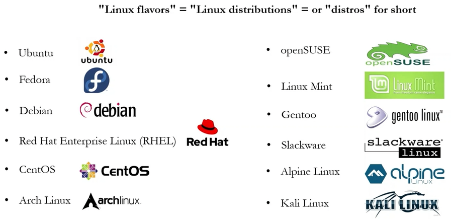
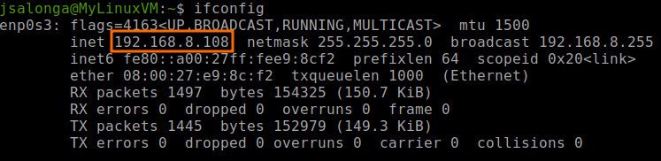
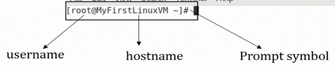
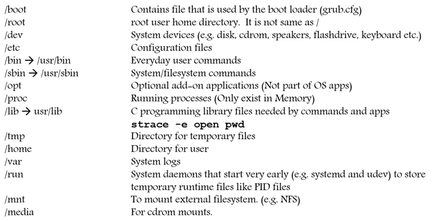
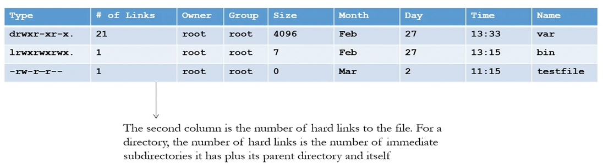
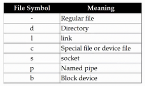

# Complete Linux Training Course

---

## Table of Contents
* [Introduction](#introduction)
* [System Access](#system-access)
    - [Access to Linux System](#access-to-linux-system)
    - [Command Prompt](#command-prompt)
    - [What is Root?](#what-is-root)
    - [Changing Password](#changing-password)
* [File System Structure and Description](#file-system-structure-and-description)
    - [Navigating File System](#navigating-file-system)
    - [Linux File or Directory Properties](#linux-file-or-directory-properties)
    - [Creating Shortcuts - Soft and Hard Links](#creating-shortcuts---soft-and-hard-links)
    - [Creating Files and Directories](#creating-files-and-directories)
    - [Copying Directories](#copying-directories)
    - [Finding Files and Directories](#finding-files-and-directories)
    - [Wildcards](#wildcards)

---

## Introduction

### What is Linux?
* Widely used in servers and cloud computing
* Free software philosophy
* Strong command line interface
* Faster processing
* Enhanced security
* Customization because of open-source nature
* There are different desktop environments like **GNOME, KDE, and XFCE**
* The file systems in use by Linux are **ext4, XFS, and Btrfs**.
* Linux **Kernel** - is NOT an operating system. It is **a small software within Linux** operating system that takes commands from users and pass them to system hardware or peripherals.

### Linux Flavors

* **Red Hat** is paid, so if you want a a free and open-source clone, use **CentOS** (but not supported/updated anymore), or use **Rocky Linux**.

---

## System Access

### Access to Linux System
* Console (local)
* Remote
    - **RDP**: Windows to Windows
    - **Sharing**: Mac to Mac
    - **Putty Client**: Windows to Linux
    - **SSH**: Windows to Linux, Mac to Linux, Linux to Linux
        - `ssh username@remote_host_ip`
        - `ssh -i ~/.ssh/my_private_key username@remote_host_ip`
        - `ssh username@remote_host_ip "df -h"` - If you want to run a quick command on the remote server without staying logged in.
    - Note: To get the IP address of the Linux Machine, run:
        - `ifconfig` (old version) or `ip a`

        

### Command Prompt

- `whoami`: shows the current username
- `hostname`: shows the hostname
- `ctrl + C`: to get your prompt back

### What is Root?
There are 3 types of root on Linux system:
1. **Root account**: root is an account or a username on Linux machine and it is the most powerful account which has access to all commands and files.

2. **Root as /**: the very first directory in Linux is also referred as root directory.

3. **Root home directory**: the root user account also has a directory located in /root which is called root home directory.

### Changing Password
* `passwd`: change the password of the current user. This will ask for your old password then input a new password.
* `passwd <userid>`: Only for root user, you can change other username's password. Example: `passwd jsalonga`
* `ctrl + D`: if you want to exit the passwd command.

---

## File System Structure and Description

### Navigating File System
* `cd`: change directory 
* `pwd`: tells you where you current location is
* `ls`: lists all the directories/files within a current working directory
    - `-la`: list all
    - `-lt`: list by time created
    - `-ltr`: list by time created (reverse)
    - `-li`: shows inodes

### Linux File or Directory Properties

### Creating Shortcuts - Soft and Hard Links
* **inode**: pointer or number of a file on the hard disk
* **Soft Link**: will be removed if file is removed or renamed
    - `ln -s`
    - Example: `ln -s ~/Desktop/data.txt`
* **Hard Link**: deleting, renaming or moving the original file will not affect the hard link. Note: Hard links only work within the same partition.
    - `ln`

* Note: You cannot create soft or hard link within the same directory with the same name.

### Creating Files and Directories
* Creating Files
    - `touch`
    - `cp`
    - `nano` or `vi` / `vim`
* Creating Directories
    - `mkdir`

### Copying Directories
* `cp -R <source folder> <destination_folder>`
* Note: Put a name if you want to change the directory's name.

### Finding Files and Directories
* `find` - iterates over a filesystem to locate files
    - `find <location where you want to find> -name "<name of the file>"`
    - Example: `find / -name "kramer"`

* `locate` - uses a prebuilt database, which should be
regularly updated by the `updatedb` command. It is faster than find.
    - `locate <filename>`
    - Example: `locate kramer`

### Wildcards
* `*`: represents zero or more characters
* `?`: represents a single character
* `{}`: represents a range of characters
* Examples:
    - `touch abcd{1..9}-xyz`
    - `ls -l ?bcd*`
    - `rm abcd*` or `rm *xyz`

---