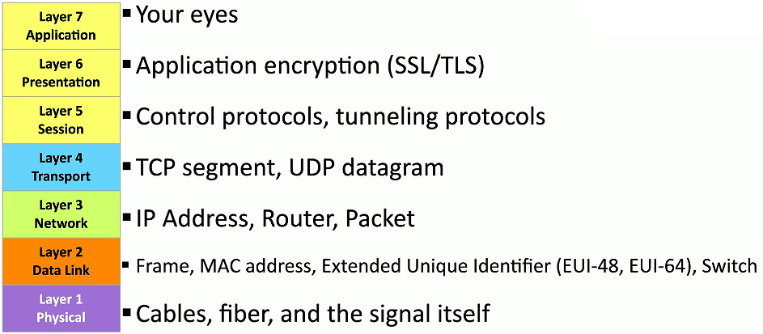

# CompTIA N10-009 Network+ Training Course
* [Youtube Link: CompTIA N10-009 Network+ Training Course](https://www.youtube.com/playlist?list=PLG49S3nxzAnl_tQe3kvnmeMid0mjF8Le8)
---
## Table of Contents
* [Understanding the OSI Model](#understanding-the-osi-model)

---

 

## Understanding the OSI Model

### What is the OSI model?
* Open Systems Interconnection Reference Model
* There are unigue protocols at every layer

### The OSI Model Layers

#### Layer 1 — Physical Layer
* The physics of the network
    - Signaling, cabling, connectors
    - This layer isn’t about protocols
* “You have a physical layer problem.”
    - Fix your cabling, punch-downs, etc. K
    - Run loopback tests, test/replace cables, swap adapter cards.

#### Layer 2 — Data Link Layer
* The basic network “language"
    - The foundation of communication at the data link layer
* Data Link Control (DLC) protocols
    - **MAC** (Media Access Control) **address** on Ethernet
* The **“switching”** layer

#### Layer 3 — Network Layer
* The **“routing”** layer
* **Internet Protocol (IP)**
* Fragments **frames** to traverse different networks

#### Layer 4 — Transport Layer
* The **“post office”** layer
    - Parcels and letters
* **TCP** (Transmission Control Protocol) and **UDP** (User Datagram Protocol)

#### Layer 5 — Session Layer
* **Communication management** between devices
    - Start, stop, restart
* **Control** protocols, **tunneling** protocols

#### Layer 6 — Presentation Layer
* **Character encoding**
* Application **encryption**
* Often combined with the Application Layer

#### Layer 7 — Application Layer
* The layer we see
* HTTP, FTP, DNS, POP3

 

---