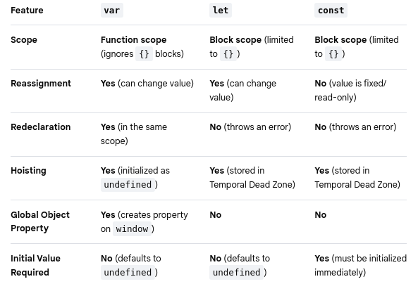
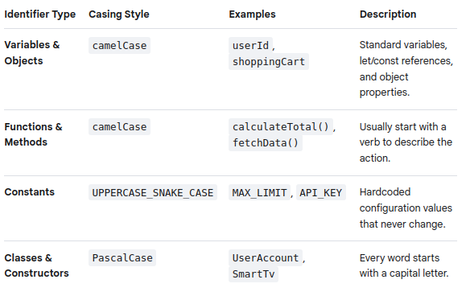
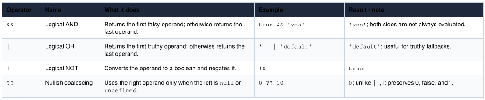
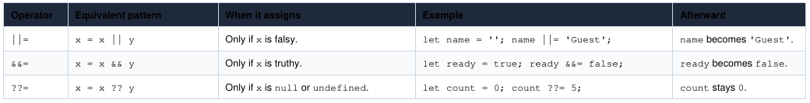
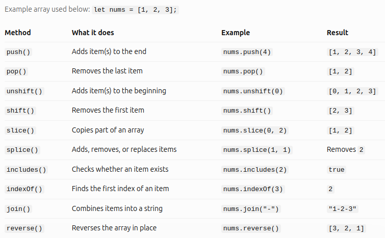
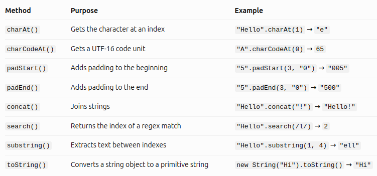
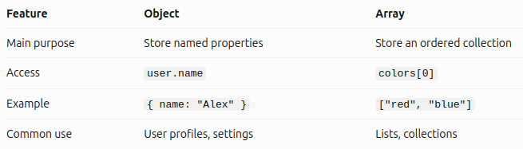
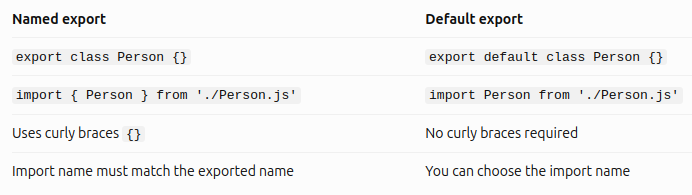
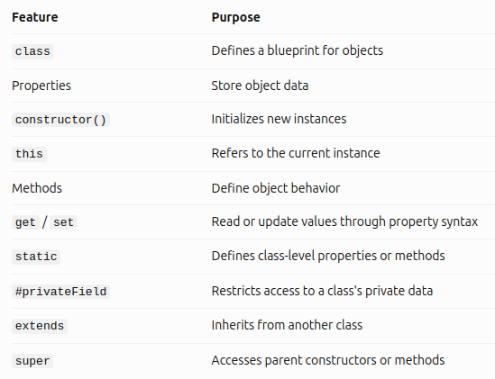

# 01 - Basic JavaScript for Automation Testing

---

## Table of Contents
* [Hello World Program](#hello-world-program)
* [Declaring the variables](#declaring-the-variables)
* [Understanding the Datatypes](#understanding-the-datatypes)
* [Conditions and Loops](#conditions-and-loops)
* [Logical Operators and Assignments](#logical-operators-and-assignments)
* [Arrays and its methods](#arrays-and-its-methods)
* [Functions](#functions)
* [String and its related methods](#string-and-its-related-methods)
* [Objects](#objects)
* [Classes and its Properties](#classes-and-its-properties)

---

<br>

## Hello World Program
* To simply print on the console/terminal:
```js
console.log("Hello World!")
```

* To add comments:
```js
// for single line comment

/*
for
multiple
lines
*/
```
* To run a javascript file on the terminal: 
    - `node <js file name>`
    - Example: `node basics1.js`

<br>

---

<br>

## Declaring the variables
* You can use var, let, or const:
    - `var`: variable name can be declared again and will replace the previous one.
    - `let`: you won't be able to repeat a variable name again if declared using **let**. Don't put "let" to re-assign the same variable name.
    - `const`: strictly NO re-assigning of the same variable name.



#### Important Notes:
* **Use `const` by default**: It prevents accidental reassignment and makes your code easier to reason about. Note that while you cannot reassign a `const` object or array, you can still modify its internal properties or elements.

* **Use `let` for variables that must change**: Perfect for loops, counters, or values you know you will reassign later.

* **Avoid `var` in modern JavaScript**: Its lack of block scoping and loose rules around redeclaration often lead to bugs.

#### Naming Style Guide



#### Naming Rules
1. **No Reserved Words**: You cannot name a variable after keywords like `const, let, if, class, function`

2. **First Character Constraints**: A name must start with a letter, an underscore (_), or a dollar sign ( $ ). **It cannot start with a number**.

3. **No Hyphens or Spaces**


#### Examples:

```js
// number variable
let a = 4
let b = 123.45
let c = a + b
// To know what type of variable
console.log(typeof (a))

// to re-assign variable for "let", don't put "let" anymore
c = "c variable is now replaced."
console.log(c)
// no re-assigning if "const" is used
const e = "You cannot use the 'e' again as a variable name!"
// e = 5 will cause an error

// string variable
let userName = "John Smith"

// boolean variable
let isRequired = true
// to reverse boolean, use "!"
console.log(!isRequired)

// null and undefined variable
let d = null
```

<br>

---

<br>

## Understanding the Datatypes


<br>

---

<br>

## Conditions and Loops

### Conditions — Making decisions
* How it works:
    - `if` checks whether the condition is true.

    - `else if` checks another condition if the previous one is false.

    - `else` runs when none of the previous conditions are true.

#### Example:

```js
const score = 85;

if (score >= 90) {
  console.log("Excellent!");
} else if (score >= 75) {
  console.log("Passed!");
} else {
  console.log("Try again.");
}
```
**Output:** Passed!

<br>

### Loops — Repeating tasks

#### A. `for` loop
Use a `for` loop **when you know how many times** you want to repeat something.

```js
for (let i = 1; i <= 4; i++) {
  console.log(i);
}
```
**Output:**
```
1
2
3
4
```
* How it works:
    - let i = 1 — starts the counter at 1.
    - i <= 4 — continues while the condition is true.
    - i++ — increases the counter by 1 after each iteration.

#### B. `for...of` loop
A modern and readable way **to loop through arrays**.

```js
const fruits = ["Apple", "Mango", "Banana"];

for (const fruit of fruits) {
  console.log(fruit);
}
```
**Output:**
```
Apple
Mango
Banana
```

#### C. `while` loop
Use a `while` loop when you want to repeat something **as long as a condition remains true**.

```js
let count = 1;

while (count <= 3) {
  console.log(count);
  count++;
}
```
**Output:**
```
1
2
3
```

#### D. `do...while` loop
Use a `do while` loop when you want the code to **run at least once, even if the condition is initially false**.

```js
let count = 1;

do {
  console.log(count);
  count++;
} while (count <= 3);
```
**Output:**
```
1
2
3
```

### Combining loops and conditions
You can use an `if` statement inside a loop to make decisions for each item.

```js
const numbers = [1, 2, 3, 4, 5];

for (const number of numbers) {
  if (number % 2 === 0) {
    console.log(`${number} is even`);
  } else {
    console.log(`${number} is odd`);
  }
}
```
**Output:**
```
1 is odd
2 is even
3 is odd
4 is even
5 is odd
```

### Loop Control Statements

* `break`: stops the loop completely.
* `continue`: skips the current iteration and proceeds to the next one.

<br>

---

<br>

## Logical Operators and Assignments

### Logical Operators



#### More Examples:

```js
// AND (&&)
console.log(5 > 3 && 10 > 7); // true

// OR (||)
console.log(5 > 3 || 10 < 7); // true

// NOT (!)
console.log(!true); // false

// Nullish coalescing (??)
console.log(null ?? "Default"); // "Default"
```

### Logical Assignment Operators



<br>

---

<br>

## Arrays and its methods

An array is a variable that stores multiple values in a single list.

```js
let fruits = ["Apple", "Banana", "Mango"];

console.log(fruits[0]); // Apple
console.log(fruits[1]); // Banana
console.log(fruits[2]); // Mango
```

### 1. Common Array Methods



**Note:** These examples assume each method starts with a fresh `nums = [1, 2, 3]`. Some methods modify the original array, while others do not.

### 2. Methods for working with array items


### 3. Other useful array features


### 4. The most important difference to remember
Some methods **modify the original array**, while others return a new value.


<br>

---

<br>

## Functions

### 1. What is a function in JavaScript?

A **function** is a reusable block of code designed to perform a specific task.

```js
function greet() {
  console.log("Hello, world!");
}

greet(); // Hello, world!
greet(); // Hello, world!
```
* **How it works:**
    - `function` — keyword used to declare a function.
    - `greet` — the function's name.
    - `()` — parentheses that can hold parameters.
    - `{}` — the function body, where the code goes.
    - `greet()` — calls or executes the function.

* **Remember:** Declaring a function doesn't automatically run it. You need to call it.

<br>

### 2. The main types of functions

#### A. Function declaration
* This is the traditional way to create a function.
```js
function add(a, b) {
  return a + b;
}

console.log(add(5, 3)); // 8
```

#### B. Function expression
* A function is stored inside a variable.
```js
const add = function(a, b) {
  return a + b;
};

console.log(add(5, 3)); // 8
```

#### C. Arrow function
* A shorter way to write a function, introduced in ES6. **Arrow functions are especially common in modern JavaScript.**
```js
const add = (a, b) => {
  return a + b;
};

console.log(add(5, 3)); // 8

// For a single expression, you can shorten it further:
const add = (a, b) => a + b;
```

#### Quick comparison


<br>

### 3. Parameters vs. arguments
* These two terms are closely related but have different meanings.
```js
function greet(name) {
  console.log("Hello, " + name);
}

greet("Alex");
```
* **Parameter:** `name` — the variable in the function definition.
* **Argument:** `"Alex"` — the actual value passed when calling the function.

You can use multiple parameters:
```js
function introduce(name, age) {
  console.log(`I'm ${name} and I'm ${age} years old.`);
}

introduce("Alex", 22);
```
**Output:** I'm Alex and I'm 22 years old.

#### Default parameters
You can provide a fallback value if an argument is omitted.
```js
function greet(name = "Guest") {
  console.log(`Hello, ${name}!`);
}

greet();       // Hello, Guest!
greet("Mia");  // Hello, Mia!
```

<br>

### 4. The `return` statement
`return` sends a value back to the code that called the function.
```js
function multiply(a, b) {
  return a * b;
}

const result = multiply(4, 5);

console.log(result); // 20
```
Compare `return` with `console.log()`:
```js
function first() {
  console.log(10);
}

function second() {
  return 10;
}
```
* `console.log()` displays a value in the console.
* `return` gives a value back so it can be stored, reused, or passed to another function.
* A function without a `return` statement returns `undefined` by default.
* Once `return` executes, the function stops running.

<br>

### 5. Scope: where variables can be accessed
Scope determines where a variable is available.

#### Global scope
```js
const name = "Alex";

function greet() {
  console.log(name);
}

greet(); // Alex
```
The variable `name` is accessible inside the function because it was declared outside it in the global scope.

#### Local or function scope
```js
function greet() {
  const message = "Hello!";
  console.log(message);
}

greet();

// console.log(message); // ReferenceError
```
The variable `message` is only accessible inside the function.

#### Block scope
Variables declared with let and const inside a block are limited to that block.
```js
if (true) {
  let age = 20;
}

// console.log(age); // ReferenceError
```

<br>

### 6. Anonymous functions and callbacks

#### Anonymous function
- is a function without a name.
```js
const greet = function() {
  console.log("Hello!");
};
```

#### Callback function
- is a function passed to another function as an argument.
```js
function processUser(callback) {
  callback();
}

processUser(function() {
  console.log("User processed!");
});
```
Callbacks are commonly used with event listeners, timers, and array methods.

For example, in the DOM:
```js
const button = document.querySelector("button");

button.addEventListener("click", () => {
  console.log("Button clicked!");
});
```
The arrow function is the callback. It runs when the button is clicked.

<br>

### 7. Higher-order functions
A higher-order function is a function that **accepts another function as an argument or returns a function**.

Array methods such as `map()`, `filter()`, and `forEach()` are common examples.
```js
const numbers = [1, 2, 3, 4];

const doubled = numbers.map(number => number * 2);

console.log(doubled); // [2, 4, 6, 8]
```

<br>

### 8. Other important function concepts

**Recursion:** A function calls itself to solve a problem in smaller steps.
```js
function countDown(n) {
  if (n <= 0) return;
  console.log(n);
  countDown(n - 1);
}

countDown(3); // 3, 2, 1
```
**Asynchronous functions:** Used when work takes time, such as fetching data from an API.
```js
async function getData() {
  const response = await fetch(
    "https://jsonplaceholder.typicode.com/users"
  );

  const data = await response.json();
  console.log(data);
}

getData();
```
`async` allows a function to return a **Promise**, while `await` waits for a **Promise to settle**.

**Closures:** A function can remember variables from the scope where it was created, even after the outer function has finished.
```js
function counter() {
  let count = 0;

  return function() {
    count++;
    return count;
  };
}

const increment = counter();

console.log(increment()); // 1
console.log(increment()); // 2
```

<br>

### 9. Common mistakes to avoid


<br>

---

<br>

## String and its related methods

### 1. What is a String?
A **string** is a data type used to represent text. You can create strings using single quotes (`' '`), double quotes (`" "`), or backticks (``).

```js
const firstName = "John";
const greeting = 'Hello!';
const message = `Welcome, ${firstName}!`;

console.log(message); // Welcome, John!
```
Backticks allow you to insert variables or expressions using **template literals** (`${...}`).

<br>

### 2. Common String Properties and Methods
Here are the most useful string methods to learn first.

#### 2.1. `length`
Returns the number of UTF-16 code units in a string.
```js
const text = "Hello";
console.log(text.length); // 5
```
#### 2.2. `toUpperCase()` and `toLowerCase()`
Convert text to uppercase or lowercase.
```js
"hello".toUpperCase(); // "HELLO"
"HELLO".toLowerCase(); // "hello"
```
#### 2.3. `includes()`
Checks whether a string contains specific text. Returns `true` or `false`.
```js
"JavaScript".includes("Script"); // true
"JavaScript".includes("Python"); // false
```
#### 2.4. `indexOf()`
Returns the index of the first occurrence of a value, or `-1` if it is not found.
```js
"banana".indexOf("a"); // 1
"banana".indexOf("z"); // -1
```
#### 2.5. `slice()`
Extracts part of a string using a start index and an optional end index (exclusive).
```js
"JavaScript".slice(0, 4); // "Java"
"JavaScript".slice(4);    // "Script"
```
#### 2.6. `replace()` and `replaceAll()`
Replace matching text with new text. `replace()` normally replaces the first matching occurrence; `replaceAll()` replaces all occurrences.
```js
"cat cat".replace("cat", "dog");
// "dog cat"

"cat cat".replaceAll("cat", "dog");
// "dog dog"
```
#### 2.7. `split()`
Splits a string into an array using a separator.
```js
"red,green,blue".split(",");
// ["red", "green", "blue"]

"hello".split("");
// ["h", "e", "l", "l", "o"]
```
#### 2.8. `trim()`
Removes whitespace from both ends of a string.
```js
"  hello  ".trim(); // "hello"
```
Related methods: `trimStart()` removes whitespace at the beginning; `trimEnd()` removes it at the end.
#### 2.9. `startsWith()` and `endsWith()`
Check whether a string starts or ends with particular text.
```js
"hello.js".startsWith("hello"); // true
"hello.js".endsWith(".js");    // true
```
#### 2.10. `repeat()`
Repeats a string a specified number of times.
```js
"Ha".repeat(3); // "HaHaHa"
```
#### 2.11. `at()`
Returns the character at an index. Negative indexes count backward from the end.
```js
"JavaScript".at(0);  // "J"
"JavaScript".at(-1); // "t"
```
#### 2.12. `match()`
Finds matches in a string using a regular expression (regex).
```js
"Order 123".match(/\d+/);
// ["123"]
```
Here, `\d+` matches one or more digits.
#### 2.13. `parseInt()`
Converts a string to an integer.
```js
let date = '23'
let nextDate = '27'
let diff = parseInt(nextDate) - parseInt(date)
console.log(diff) // 4
```

<br>

### 3. Other useful string methods



<br>

### 4. Important concepts to remember
#### 4.1. Strings are immutable.
This means string methods do not modify the original string; they return a new string or another value.
```js
let text = "hello";

text.toUpperCase();

console.log(text); // "hello"

text = text.toUpperCase();

console.log(text); // "HELLO"
```
#### 4.2. String indexes start at zero.
```js
const word = "CODE";

// Index:  0 1 2 3
// Letter: C O D E

console.log(word[0]); // "C"
console.log(word[3]); // "E"
```
#### 4.3. String comparisons are case-sensitive.
```js
console.log("hello" === "Hello"); // false
console.log("JavaScript".includes("java")); // false
```
#### 4.4. Template literals
are useful for combining strings and variables.
```js
const name = "Alex";
const age = 20;

console.log(`My name is ${name} and I am ${age}.`);
// My name is Alex and I am 20.
```

<br>

---

<br>

## Objects

### 1. What is an Object in JavaScript?
An **object** stores related data and functionality using `key: value` pairs. It is useful for representing real-world things such as a person, a car, or a product.
```js
const person = {
  name: "Alex",
  age: 25,
  city: "Manila"
};

console.log(person);
```

<br>

### 2. Accessing Object Properties

#### 2.1. Dot notation (`.`)
Access a property by its name.
```js
console.log(person.name); // "Alex"
console.log(person.age);  // 25
```
#### 2.2. Bracket notation (`[]`)
Access a property using a string or a variable. This is useful when property names contain spaces or are stored in variables.
```js
console.log(person["city"]); // "Manila"

const key = "name";
console.log(person[key]); // "Alex"
```

<br>

### 3. Adding, Updating, and Deleting Properties
You can modify objects after creating them, even when they are declared with `const`.
```js
const person = {
  name: "Alex",
  age: 25
};

// Add a property
person.city = "Manila";

// Update a property
person.age = 26;

// Delete a property
delete person.city;

console.log(person);
// { name: "Alex", age: 26 }
```
Remember: `const` prevents reassignment of the object variable, but it does not prevent changes to the object's properties.

<br>

### 4. Object Methods
An object can contain functions. A function stored in an object is commonly called a **method**.
```js
const person = {
  name: "Alex",

  greet() {
    return `Hello, I'm ${this.name}!`;
  }
};

console.log(person.greet());
// "Hello, I'm Alex!"
```
* `greet()` is a method.
* `this.name` refers to the name property of the object when called this way.

<br>

### 5. Important Object Methods and Utilities
JavaScript provides built-in methods that help you inspect, copy, and work with objects.

#### 5.1. `Object.keys()`
Returns an array of an object's own enumerable property names.
```js
const user = { name: "Alex", age: 25 };

console.log(Object.keys(user));
// ["name", "age"]
```
#### 5.2. `Object.values()`
Returns an array of the object's property values.
```js
console.log(Object.values(user));
// ["Alex", 25]
```
#### 5.3. `Object.entries()`
Returns an array of key-value pairs, with each pair represented as an array.
```js
console.log(Object.entries(user));
// [["name", "Alex"], ["age", 25]]
```
#### 5.4. `Object.assign()`
Copies enumerable own properties from one or more source objects into a target object.
```js
const extra = { city: "Manila" };
const result = Object.assign({}, user, extra);

console.log(result);
// { name: "Alex", age: 25, city: "Manila" }
```
#### 5.5. `Object.hasOwn()`
Checks whether an object has a property directly on itself, rather than inheriting it.
```js
console.log(Object.hasOwn(user, "name")); // true
console.log(Object.hasOwn(user, "city")); // false
```
#### 5.6. `Object.freeze()`
Prevents properties from being added, removed, or reassigned on the object itself.
```js
const settings = { theme: "dark" };

Object.freeze(settings);
settings.theme = "light";

console.log(settings.theme); // "dark"
```

<br>

### 6. Modern JavaScript Object Features (ES6+)
These features are especially useful in everyday JavaScript.

#### 6.1. Property shorthand
When the variable name and property name are the same, you can write the name once.
```js
const name = "Alex";
const age = 25;

const user = { name, age };
```
#### 6.2. Destructuring
Extract properties into variables.
```js
const user = {
  name: "Alex",
  age: 25
};

const { name, age } = user;

console.log(name); // "Alex"
```
#### 6.3. Spread syntax (`...`)
Copies an object's enumerable own properties into a new object. Later properties override earlier ones.
```js
const user = { name: "Alex", age: 25 };

const updated = { ...user, age: 26 };

console.log(updated);
// { name: "Alex", age: 26 }
```
#### 6.4. Optional chaining (`?.`)
Safely accesses a property when an intermediate value might be `null` or `undefined`.
```js
const user = {};

console.log(user.address?.city);
// undefined
```
#### 6.5. Nullish coalescing (`??`)
Provides a default value only when the left side is null or undefined.
```js
const user = { name: null };

console.log(user.name ?? "Guest");
// "Guest"
```
#### 6.6. Computed property names
Create a property name dynamically using an expression inside square brackets.
```js
const key = "favoriteColor";

const user = {
  [key]: "blue"
};

console.log(user.favoriteColor); // "blue"
```

<br>

### 7. Looping Through Objects
Use `Object.entries()` with `for...of` to access each key and value.
```js
const user = {
  name: "Alex",
  age: 25,
  city: "Manila"
};

for (const [key, value] of Object.entries(user)) {
  console.log(`${key}: ${value}`);
}
```
**Output:**
```
name: Alex
age: 25
city: Manila
```
You can also use `for...in` to iterate over enumerable string-keyed properties, including inherited ones.
```js
for (const key in user) {
  console.log(key, user[key]);
}
```
For ordinary objects, prefer `Object.keys()`, `Object.values()`, or `Object.entries()` when you want to work specifically with the object's own properties.

<br>

### 8. Object vs. Array



An array is also a type of object in JavaScript, but it is designed specifically for ordered collections.

<br>

---

<br>

## Classes and its Properties

### 1. What is a Class?
A **class** is a blueprint for creating objects. It defines the data and behavior that objects can have.
```js
class Person {
  greet() {
    console.log("Hello!");
  }
}

const user = new Person();
user.greet(); // Hello!
```
* `class` defines a class.
* `Person` is the class name.
* `new Person()` creates an instance (object).
* `greet()` is a method.

<br>

### 2. Class Properties and Features
#### 2.1. Properties
Properties store data inside an object.
```js
class Person {
  name = "Alex";
  age = 25;
}

const p = new Person();
console.log(p.name); // Alex
```
`name` and `age` are instance properties.
#### 2.2. Constructor
The `constructor()` method initializes an object's properties when you create it.
```js
class Person {
  constructor(name, age) {
    this.name = name;
    this.age = age;
  }
}

const p = new Person("Alex", 25);
```
`this` refers to the current instance.
#### 2.3. Methods
Methods are functions defined inside a class that describe what an object can do.
```js
class Person {
  greet() {
    return "Hello!";
  }
}

console.log(new Person().greet());
// Hello!
```
Methods are usually shared through the class prototype.
#### 2.4. Getters and Setters
They let you access or update properties using property-like syntax.
```js
class Person {
  constructor(name) {
    this._name = name;
  }

  get name() {
    return this._name;
  }

  set name(value) {
    this._name = value;
  }
}

const p = new Person("Alex");
p.name = "Sam";
console.log(p.name); // Sam
```
`get` reads a value; `set` updates it.
#### 2.5. Static Properties and Methods
These belong to the class itself, not individual instances.
```js
class MathHelper {
  static PI = 3.14159;

  static square(n) {
    return n * n;
  }
}

console.log(MathHelper.PI);
console.log(MathHelper.square(4)); // 16
```
Access them using `MathHelper`, not an instance of the class.
#### 6. Private Properties
Prefix a property with `#` to make it private to the class.
```js
class BankAccount {
  #balance = 100;

  getBalance() {
    return this.#balance;
  }
}

const account = new BankAccount();
console.log(account.getBalance()); // 100
// account.#balance causes a SyntaxError
```
Private fields cannot be accessed directly from outside the class.
#### 7. Inheritance (`extends` and `super`)
Inheritance lets one class reuse or extend another class's functionality.
```js
class Animal {
  speak() {
    console.log("Animal sound");
  }
}

class Dog extends Animal {}

new Dog().speak(); // Animal sound
```
`extends` establishes inheritance. `super()` calls the parent constructor when needed, while `super.method()` calls a parent method.
#### 8. Exporting / Importing a Class

##### 8.1. Using `export` and `import`
* **Exporting a class** - Suppose you have a file named `Person.js`:
```js
// Person.js
export class Person {
  constructor(name) {
    this.name = name;
  }

  greet() {
    console.log(`Hello, I'm ${this.name}!`);
  }
}
```
* **Importing a class** - In another file, such as `main.js`:
```js
// main.js
import { Person } from './Person.js';

const person1 = new Person('Alex');
person1.greet();

// Output: Hello, I'm Alex!
```

##### 8.2. Using `export default`
* **export default** - You can also export a class as the default export:
```js
// Person.js
export default class Person {
  constructor(name) {
    this.name = name;
  }
}
```
* Then import it **without curly braces**:
```js
// main.js
import Person from './Person.js';

const person1 = new Person('Alex');
```

##### Quick Comparison



##### One important thing
To use ES Modules in a browser, include your main JavaScript file in HTML with `type="module"`:
```html
<script type="module" src="./main.js"></script>
```

<br>

### 3. Quick summary



<br>

---