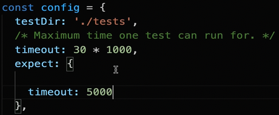
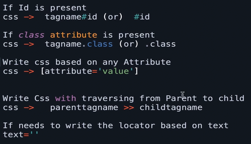
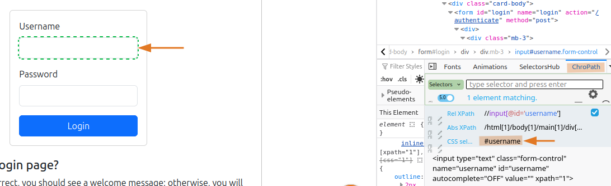
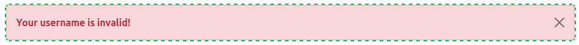
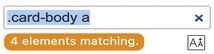
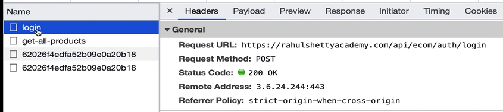
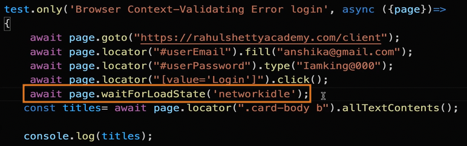
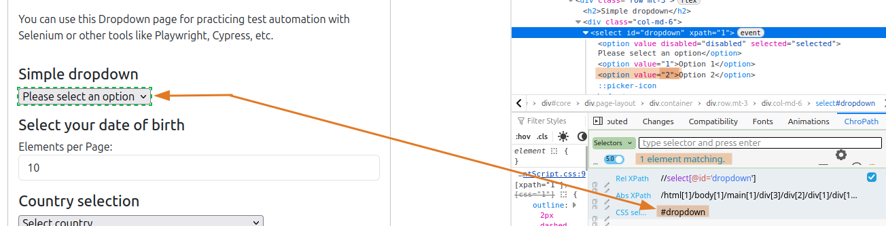
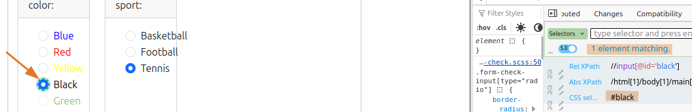
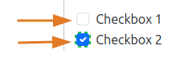

# 01 - Playwright Fundamentals

---

## Table of Contents
* [Getting Started with Playwright Automation Core Concepts](#getting-started-with-playwright-automation-core-concepts)
* [Playwright Basic Methods for Web Automation Testing](#playwright-basic-methods-for-web-automation-testing)
* [Handling UI Components](#handling-ui-components)

---

<br>

## Getting Started with Playwright Automation Core Concepts

### Create npm Project and install Playwright dependencies for testing
1. Create a new project directory.
2. In this directory, open terminal.
3. Run `npm init playwright`.
4. Select the following: **JavaScript -> tests -> true**

### Importance of Playwright Test Annotation and async await understanding
1. In the **tests** directory, create a new practice test file : `UIBasicstest.spec.js`
2. This is the common test case syntax:
```js
const {test} = require('@playwright/test');

test('First Playwright test', async ()=>
{
    // playwright code
    // step 1 - open browser
    await
    // step 2
});
```
* `async` means your code will run in **sequential order**, `await` means it will wait for the first step to finish before proceeding to the next step.
* `await` will NOT work if you forgot to put `async`

### What is browser context and Page fixtures in Playwright
```js
const { test } = require('@playwright/test');

test('Browser Context Playwright test', async ({ browser }) => {
    const context = await browser.newContext(); // you can add cookies here if needed
    const page = await context.newPage();
    await page.goto("https://practice.expandtesting.com/login");
});

test('Page Playwright test', async ({ page }) => {
    await page.goto("https://google.com/");
});
```
* Use the `{browser}` fixture if you need to add cookies or plugins on the browser. If you only need a fresh instance, `{page}` fixture is enough.

### Importance of Playwright configuration file and its details

#### Customizing your own config object

1. Open `playwright.config.js`
2. You can change here the following:
    - **tests directory:** choose which test will run.
    - **test timeout:** default is 30secs for each test. You can override it here.
    - **global timeout:** for assertion validation timeout. Default is also 30secs, change it only if you need to override it.
    - **browsers:** which browsers will be used on your tests
3. Sample customized **config** object:


#### Running the playwright.config.js
1. Open the terminal on your project directory.
2. Run `npx playwright test` to run all the tests in your `./tests` directory.
    - default test run is headless
    - to see the browser execution, add `--headed` on the command
    - or in your **playwright.config.js**, in `use:` add `headless: false`

3. If you have several tests inside your javascript file, you can add `.only` to the test that you only want to execute.
```js
const {test} = require('@playwright/test');

test.only('Page Playwright test', async ({page})=>
{
    await page.goto("https://google.com/");
});
```

### Setup Assertions in Playwright tests & multiple browsers Configuration

```js
// get test and expect fixtures from the playwright module
const {test, expect} = require('@playwright/test');

test.only('Page Playwright test', async ({page})=>
{
    await page.goto("https://google.com/");

    // get title - assertion
    console.log(await page.title());
    await expect(page).toHaveTitle("Google");
});
```
* To provide a 5 seconds timeout for the **expect** method, add this in the **playwright.config.js**:



<br>

---

<br>

## Playwright Basic Methods for Web Automation Testing

### Using locator() method to select an element

* Prefer using **css locators** rather than **xpath locators**.
* Rules for using **css locator**:



* On your target website:
1. Use **Inspect** or hit **(F12)**.
2. Pick the target element, in this example, the **Username input box**.
3. Use **ChroPath** browser extension to see the css selector value. (or **SelectorsHub** extension)



Note: Better to create variables for the locators in your test. Example:
```js
const userName = page.locator("#username")
```

4. Do the same process with **Password input box**, to fill them.
5. Do the same process with the **Login** button, to click it.

```js
const { test, expect } = require('@playwright/test');

test('Login test - Correct Credentials', async ({ page }) => {
    await page.goto("https://practice.expandtesting.com/login");

    // login - correct credentials
    await page.locator("#username").fill("practice");
    await page.locator("#password").fill("SuperSecretPassword!");
    await page.locator("#submit-login").click();
```

6. Create a new test that provides a wrong password.
    - Get the **css selector** of the pop-up error.

    

    - Then **print** its **error message** by using the `textContent()` method.
    - Then **expect** the correct **error message** by using `toContainText` method. 

```js
const { test, expect } = require('@playwright/test');

test('Login test - Wrong Password', async ({ page }) => {
    await page.goto("https://practice.expandtesting.com/login");

    // login - wrong password
    await page.locator("#username").fill("practice");
    await page.locator("#password").fill("WrongPassword!");
    await page.locator("#submit-login").click();
    console.log(await page.locator("#flash").textContent());
    await expect(page.locator("#flash")).toContainText("Your password is invalid!");
});
```

#### Deleting a filled input box
If you already filled up an input box, **you can make it blank again** by using the **fill** method again. Example:
```js
await page.locator("#username").fill("");
```

<br>

### How to work with locators that extract multiple web elements

#### 1. Index
If your locator is selecting multiple elements, you can select the correct element by putting its index.



```js
console.log(await page.locator(".card—body a").nth(0).textContent());
```
In this example the locator is selecting 4 elements, to get the first one, specify the `0` index.

#### 2. first or last
You can select the correct element by putting **first** or **last**. This is only applicable with **first** and **last**, there are no second, third, fourth and so on.
```js
console.log(await page.locator(".card—body a").first().textContent());
```

#### 3. Listing all the elements
If you want to have an **array** of elements that your locator is selecting, use the `allTextContents()` method.
```js
console.log(await page.locator(".card—body a").allTextContents());
```
This is useful if you need an array for you loop code.

<br>

### Techniques to wait dynamically for new page in Service based applications

* **Inspect -> Network tab -> Fetch/XHR tab** - to see how data load on your browser.



* `waitForLoadState()` method - is used to **wait until all the network calls are completed**. In this example after logging in it will wait for the 4 calls (login, get-all-products...) to load first.
    

    - Without this, your next method (allTextContents) might return an empty array, because it will not load all the data.

* `waitFor()` method - is a better alternative than using **networkidle**. In this example if you know that `".card—body b"` has 8 elements, wait for the last index to load.
```js
await page.locator(".card—body b").nth(7).waitFor();

const titles = await page. locator(".card—body b").allTextContents();
console.log(titles);
```

<br>

---

<br>

## Handling UI Components

### Selecting an Option from a Static Dropdown List
1. Get the **locator** of the dropdown.
2. Get the value of the option that you want, then put it in the `selectOption()` method.
3. Assert the value by using the `toHaveValue()` method.



```js
const { test, expect } = require('@playwright/test');

test('UI Dropdown', async ({ page }) => {
    const url = "https://practice.expandtesting.com/dropdown";
    const dropdownSimple = page.locator("#dropdown");

    await page.goto(url);

    // Select dropdown
    await dropdownSimple.selectOption("2"); // put here the option value
    // Assert if option value 2 is selected
    await expect(dropdownSimple).toHaveValue("2");
    // Just to see what's happening if you are in headed mode
    await page.pause();
});
```

### Selecting a Radio Button
1. Get the **locator** of the radio button.
2. Use the `click()` method to select.
3. Assert it by using `toBeChecked()` method.



```js
const { test, expect } = require('@playwright/test');

test('UI Radio Button - Select black color', async ({ page }) => {
    const url = "https://practice.expandtesting.com/radio-buttons";
    const radioButtonColor = page.locator("#black");

    await page.goto(url);

    // Select radio button black
    await radioButtonColor.click();
    // Assert if black is selected
    await expect(radioButtonColor).toBeChecked();
});
```

### Selecting / deselecting on Check Boxes
In this example, checkbox 2 is already selected by default. We want to select checkbox 1, and deselect checkbox 2:
1. Get the **locators** of both checkboxes.
2. Use the `click()` method to put check on the first one.
3. Use also the `click` method to uncheck the second one.
4. To assert the first one if checked, use `toBeChecked()`.
5. To assert the second one if unchecked, use `not.toBeChecked()` method.



```js
test('UI Check Boxes', async ({ page }) => {
    const url = "https://practice.expandtesting.com/checkboxes";
    const checkBox1 = page.locator("#checkbox1");
    const checkBox2 = page.locator("#checkbox2");

    await page.goto(url); // Checkbox 2 is checked by default

    // Click the first checkbox to check it
    await checkBox1.click();
    // Click the second checkbox to uncheck it
    await checkBox2.click();
    // Assert if checkbox 1 is checked and checkbox 2 is not selected anymore
    await expect(checkBox1).toBeChecked();
    await expect(checkBox2).not.toBeChecked();
});
```

### Redirect Link opens on the same page
In this example, you will click the **redirect link text** that opens on the same page, and assert that this page has the text title "Status Codes".
```js
test('UI Redirect Link - Same page window', async ({ page }) => {
    const url1 = "https://practice.expandtesting.com/redirector";
    const url2 = "https://practice.expandtesting.com/status-codes";
    const redirectLink = page.locator("#redirect");
    const textTitle = page.locator("//h1[contains(text(),'Status Codes')]");

    await page.goto(url1);

    // Click the redirect link
    await redirectLink.click();

    // Assert we are now on url2 and the "Status Codes" title is present
    await expect(page).toHaveURL(url2);
    await expect(textTitle).toBeVisible();
    await expect(textTitle).toHaveText("Status Codes");
});
```

### Redirect Link opens on a new browser window
In this example, you will click the **redirect link text** that opens on a new browser window, and assert that this page has the text title "Status Codes".
* **Note:** Aside from the **page** fixture, we also need to add the **context** fixture.
```js
test('UI Redirect Link - New Tab', async ({ page, context }) => {
    const url1 = "https://practice.expandtesting.com/redirector";
    const url2 = "https://practice.expandtesting.com/status-codes";
    const redirectLink = page.locator("#redirect");

    await page.goto(url1);

    // Wait for the new page to open while clicking the link
    const newPagePromise = context.waitForEvent('page');

    await page.locator("#redirect").click();

    const newPage = await newPagePromise;

    // Wait for the new page to load
    await newPage.waitForLoadState();

    // Verify the destination URL and title
    await expect(newPage).toHaveURL(url2);

    const textTitle = newPage.locator("//h1[contains(text(),'Status Codes')]");

    await expect(textTitle).toBeVisible();
    await expect(textTitle).toHaveText("Status Codes");
});
```

<br>

---