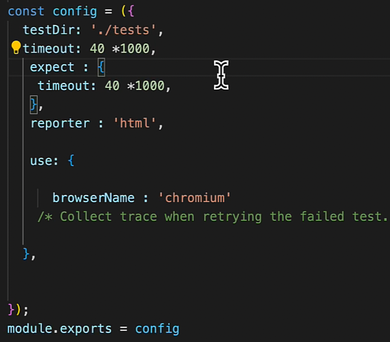

# 01 - Playwright Fundamentals

---

## Table of Contents
* [Getting Started with Playwright Automation Core Concepts](#getting-started-with-playwright-automation-core-concepts)

---

<br>

## Getting Started with Playwright Automation Core Concepts

### Create npm Project and install Playwright dependencies for testing
1. Create a new project directory.
2. In this directory, open terminal.
3. Run `npm init playwright`.
4. Select the following: **JavaScript -> tests -> true**

### Importance of Playwright Test Annotation and async await understanding
1. In the **tests** directory, create a new practice test file : `UIBasicstest.spec.js`
2. This is the common test case syntax:
```js
const {test} = require('@playwright/test');

test('First Playwright test', async ()=>
{
    // playwright code
    // step 1 - open browser
    await
    // step 2
});
```
* `async` means your code will run in **sequential order**, `await` means it will wait for the first step to finish before proceeding to the next step.
* `await` will NOT work if you forgot to put `async`

### What is browser context and Page fixtures in Playwright
```js
const {test} = require('@playwright/test');

test('Browser Context Playwright test', async ({browser,page})=>
{
    const context = await browser.newContext(); // you can add cookies here if needed
    const page = await context.newPage();
    await page.goto("https://rahulshettyacademy.com/loginpagePractise/")
});

test('Page Playwright test', async ({page})=>
{
    await page.goto("https://google.com/")
});
```
* Only add the `{browser}` fixture if you need to add cookies or plugins on the browser. If you only need a fresh instance, `{page}` fixture is enough.

### Importance of Playwright configuration file and its details

#### Customizing your own config object

1. Open `playwright.config.js`
2. You can change here the following:
    - **tests directory:** choose which test will run.
    - **test timeout:** default is 30secs for each test. You can override it here.
    - **global timeout:** for assertion validation timeout. Default is also 30secs, change it only if you need to override it.
    - **browsers:** which browsers will be used on your tests
3. Sample customized **config** object:



#### Running the playwright.config.js
1. Open the terminal on your project directory.
2. Run `npx playwright test` to run all the tests in your `./tests` directory.
    - default test run is headless
    - to see the browser execution, add `--headed` on the command
    - or in your **playwright.config.js**, in `use:` add `headless: false`

3. If you have several tests inside your javascript file, you can add `.only` to the test that you only want to execute.
```js
const {test} = require('@playwright/test');

test.only('Page Playwright test', async ({page})=>
{
    await page.goto("https://google.com/")
});
```

### Setup Assertions in Playwright tests & multiple browsers Configuration

```js
// get test and expect fixtures from the playwright module
const {test, expect} = require('@playwright/test');

test.only('Page Playwright test', async ({page})=>
{
    await page.goto("https://google.com/")

    // get title - assertion
    console.log(await page.title());
    await expect(page).toHaveTitle("Google");
});
```

<br>

---