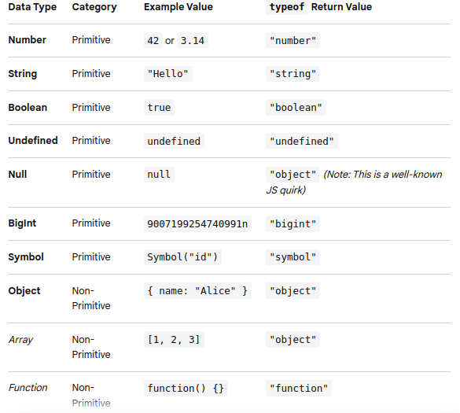
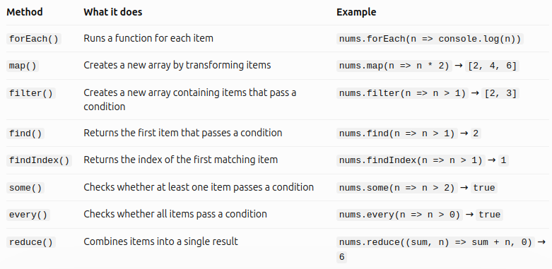
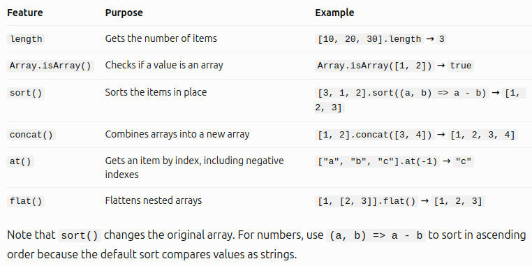
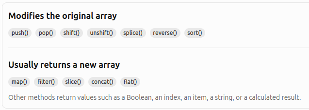

# Basic JavaScript for Automation Testing

---

## Table of Contents
* [Hello World Program](#hello-world-program)
* [Declaring the variables](#declaring-the-variables)
* [Understanding the Datatypes](#understanding-the-datatypes)
* [Conditions and Loops](#conditions-and-loops)
* [Logical Operators and Assignments](#logical-operators-and-assignments)
* [Arrays and its methods](#arrays-and-its-methods)
* [Functions](#functions)
* [String and its related functions](#string-and-its-related-functions)
* [What are JavaScript Objects?](#what-are-javascript-objects)
* [Classes and its Properties](#classes-and-its-properties)
* [Methods](#methods)

---

## Hello World Program
* To simply print on the console/terminal:
```js
console.log("Hello World!")
```

* To add comments:
```js
// for single line comment

/*
for
multiple
lines
*/
```
* To run a javascript file on the terminal: 
    - `node <js file name>`
    - Example: `node basics1.js`

---

## Declaring the variables
* You can use var, let, or const:
    - `var`: variable name can be declared again and will replace the previous one.
    - `let`: you won't be able to repeat a variable name again if declared using **let**. Don't put "let" to re-assign the same variable name.
    - `const`: strictly NO re-assigning of the same variable name.


#### Important Notes:
* **Use `const` by default**: It prevents accidental reassignment and makes your code easier to reason about. Note that while you cannot reassign a `const` object or array, you can still modify its internal properties or elements.

* **Use `let` for variables that must change**: Perfect for loops, counters, or values you know you will reassign later.

* **Avoid `var` in modern JavaScript**: Its lack of block scoping and loose rules around redeclaration often lead to bugs.

#### Naming Style Guide


#### Naming Rules
1. **No Reserved Words**: You cannot name a variable after keywords like `const, let, if, class, function`

2. **First Character Constraints**: A name must start with a letter, an underscore (_), or a dollar sign ( $ ). **It cannot start with a number**.

3. **No Hyphens or Spaces**


#### Examples:

```js
// number variable
let a = 4
let b = 123.45
let c = a + b
// To know what type of variable
console.log(typeof (a))

// to re-assign variable for "let", don't put "let" anymore
c = "c variable is now replaced."
console.log(c)
// no re-assigning if "const" is used
const e = "You cannot use the 'e' again as a variable name!"
// e = 5 will cause an error

// string variable
let userName = "John Smith"

// boolean variable
let isRequired = true
// to reverse boolean, use "!"
console.log(!isRequired)

// null and undefined variable
let d = null
```

---

## Understanding the Datatypes



---

## Conditions and Loops

### Conditions — Making decisions
* How it works:
    - `if` checks whether the condition is true.

    - `else if` checks another condition if the previous one is false.

    - `else` runs when none of the previous conditions are true.

#### Example:

```js
const score = 85;

if (score >= 90) {
  console.log("Excellent!");
} else if (score >= 75) {
  console.log("Passed!");
} else {
  console.log("Try again.");
}
```
**Output:** Passed!

<br>

### Loops — Repeating tasks

#### A. `for` loop
Use a `for` loop **when you know how many times** you want to repeat something.

```js
for (let i = 1; i <= 4; i++) {
  console.log(i);
}
```
**Output:**
```
1
2
3
4
```
* How it works:
    - let i = 1 — starts the counter at 1.
    - i <= 4 — continues while the condition is true.
    - i++ — increases the counter by 1 after each iteration.

#### B. `for...of` loop
A modern and readable way **to loop through arrays**.

```js
const fruits = ["Apple", "Mango", "Banana"];

for (const fruit of fruits) {
  console.log(fruit);
}
```
**Output:**
```
Apple
Mango
Banana
```

#### C. `while` loop
Use a `while` loop when you want to repeat something **as long as a condition remains true**.

```js
let count = 1;

while (count <= 3) {
  console.log(count);
  count++;
}
```
**Output:**
```
1
2
3
```

#### D. `do...while` loop
Use a `do while` loop when you want the code to **run at least once, even if the condition is initially false**.

```js
let count = 1;

do {
  console.log(count);
  count++;
} while (count <= 3);
```
**Output:**
```
1
2
3
```

### Combining loops and conditions
You can use an `if` statement inside a loop to make decisions for each item.

```js
const numbers = [1, 2, 3, 4, 5];

for (const number of numbers) {
  if (number % 2 === 0) {
    console.log(`${number} is even`);
  } else {
    console.log(`${number} is odd`);
  }
}
```
**Output:**
```
1 is odd
2 is even
3 is odd
4 is even
5 is odd
```

### Loop Control Statements

* `break`: stops the loop completely.
* `continue`: skips the current iteration and proceeds to the next one.

---

## Logical Operators and Assignments

### Logical Operators


#### More Examples:

```js
// AND (&&)
console.log(5 > 3 && 10 > 7); // true

// OR (||)
console.log(5 > 3 || 10 < 7); // true

// NOT (!)
console.log(!true); // false

// Nullish coalescing (??)
console.log(null ?? "Default"); // "Default"
```

### Logical Assignment Operators


---

## Arrays and its methods

An array is a variable that stores multiple values in a single list.

```js
let fruits = ["Apple", "Banana", "Mango"];

console.log(fruits[0]); // Apple
console.log(fruits[1]); // Banana
console.log(fruits[2]); // Mango
```

### 1. Common Array Methods


**Note:** These examples assume each method starts with a fresh `nums = [1, 2, 3]`. Some methods modify the original array, while others do not.

### 2. Methods for working with array items



### 3. Other useful array features



### 4. The most important difference to remember
Some methods **modify the original array**, while others return a new value.



---

## Functions

---

## String and its related functions

---

## What are JavaScript Objects?

---

## Classes and its Properties

---

## Methods

---