# Gimp Photo Editing

---

## Table of Contents
* [Navigation](#navigation)
* [Rotating, Cropping, and Layers](#rotating-cropping-and-layers)
* [Exposure and Shadows-Highlights Function](#exposure-and-shadows-highlights-function)
* [Color Temperature and Hue-Saturation Functions](#color-temperature-and-hue-saturation-functions)
* [Histogram and Color Balance Functions](#histogram-and-color-balance-functions)
* [Clone Tool to Remove Distractions](#clone-tool-to-remove-distractions)
* [Adding a Watermark and Exporting the Final Edit](#adding-a-watermark-and-exporting-the-final-edit)
* [How to Open RAW Images in GIMP](#how-to-open-raw-images-in-gimp)
* [Different Precision Modes of Editing](#different-precision-modes-of-editing)
* [Levels Function to Correct the Colors - White Balance](#levels-function-to-correct-the-colors---white-balance)
* [Color Balance Function to Fine-tune the Colors](#color-balance-function-to-fine-tune-the-colors)
* [Healing Tool to Retouch the Skin](#healing-tool-to-retouch-the-skin)
* [Unsharp Mask Function to Sharpen Texture](#unsharp-mask-function-to-sharpen-texture)
* [Layer Masking to do Localized Editing](#layer-masking-to-do-localized-editing)
* [Selections](#selections)
* [Frequency Separation to Make the Skin Smooth](#frequency-separation-to-make-the-skin-smooth)
* [How to Merge Different Exposures](#how-to-merge-different-exposures)
* [Changing the Color of the Background](#changing-the-color-of-the-background)

---

## Navigation
* Open a file: drag photo file in Gimp
* Zoom in/out: `ctrl + mouse wheel`
* Move around: hold `spacebar`
* Zoom fit: `ctrl + shift + J`
* Undo history window: `Window -> Dockable Dialogs -> Undo History`
* Tool Options window: `Window -> Dockable Dialogs -> Tool Options`
* Save the project as an **xcf** to save your layers

---

## Rotating, Cropping, and Layers
* Rotate: `shift + R`
* Crop: `shift + C`
* Duplicate layer: `ctrl + shift + D`

---

## Exposure and Shadows-Highlights Function
* **Note:** Create a new layer first before adjusting the brightness/exposure of an image.

* To adjust the **overall** brightess or exposure of the whole image:
    - `Colors -> Exposure...`
        - Increase the **Exposure** option to increase the brightness of the whole image.

* To adjust the brightness of just a **part** of the image:
    - `Colors -> Shadows-Highlights...`
        - Increase the value of **Shadows** option to increase the brightness of the dark parts
        - Optional: Lower the **Highlights** value to make the bright parts darker
        - **Note**: It is better to increase the brightness of the photo as lowering it too much will lose its quality.

---

## Color Temperature and Hue-Saturation Functions
* **Note:** Create again a new layer first before adjusting the temperature and saturation of an image.

* Adjust the **Color Temperature** to adjust the **warmness** of an image (increase or decrease orange/red)
    - `Colors -> Color Temperature...`
        - Play with the **Original temperature** and **Intended temperature** options to eyeball the desired warmness.

* Adjust the **Hue-Saturation** to select a primary color to adjust.
    - `Colors -> Hue-Saturation...`

---

## Histogram and Color Balance Functions
* **Note:** Create a new layer.

* `Colors -> Info -> Histogram` - to view the image balance (if the luminance is balanced, which color is dominating, etc.)
    - Left side - dark tones
    - Right side - light tones
    - Middle - middle tones

* You can then adjust and balance them using `Colors -> Color Balance...`

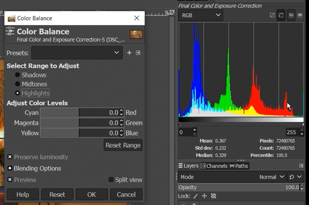

---

## Clone Tool to Remove Distractions
* **Note:** Create a new layer.
* Press `C`
    - Adjust the brush size in the **Tool Options** (or press-hold `[]`)
    - Hold `ctrl` then click the part that you want to clone
    - Then click on the areas that you want to be painted.

---

## Adding a Watermark and Exporting the Final Edit
* Open your watermark image (png) in Gimp.
* Drag its **tab** to your target image.
* Resize / scale it - `shift + S`
* Use the move tool (press `M`) to your desired location.
* On the layer window, adjust its opacity.
* `File -> Export As...` then choose a file type (example: jpg)

---

## How to Open RAW Images in GIMP
- Edit the image RAW file (**.NEF**) for better result.
- Install **darktable**: https://www.darktable.org/
- Open the RAW file using Gimp, it will open first in darktable, close darktable and it will continue to open in Gimp.

---

## Different Precision Modes of Editing

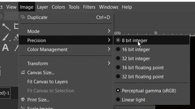

* It is better to do **color correcting using 16-32 bit** integer if you are using a powerful computer.
* Leave it at **8 bit** if you have a weak computer.

---

## Levels Function to Correct the Colors - White Balance
* Duplicate the layer: `ctrl + shift + D`

* Fast method (usually not good result):
    - `Colors -> Auto -> White Balance`

* Auto Method using **Levels**:
    - `Colors -> Levels...`
        - Then try the 3 options below to see which will give the best result. How this works:
            - Click the **Pick white point** then click a **white** color on your image. (Just keep on clicking the image until it adjusts.) Hit **Reset** then try the next one.
            - Click the **Pick gray point** then click a **gray** color on your image.
            - Click the **Pick black point** then click a **black** color on your image.
            - **Note:** Use the bracket keys `[]` to adjust the size of the brush.

            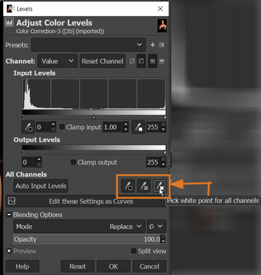
        
        - If none of the 3 options gave you a good result, you could also try clicking the **Auto Input Levels** button (button located on their left side). Then try different modes on the **Blending Options** (example: HSL Color)

---

## Color Balance Function to Fine-tune the Colors
* Duplicate the layer: `ctrl + shift + D`

* `Colors -> Color Balance...`
    - Select Range to Adjust:
        - **Shadows:** If you want to adjust the darkness of a color.
        - **Midtones:** If you want to adjust the colors/hue - which we will use mostly to correct the colors.
        - **Highlights:** If you want to adjust the brightness of the color.
    - After clicking the radio button that you want, **Adjust Color Levels** to eyeball the needed adjustment.

---

## Healing Tool to Retouch the Skin
* Duplicate the layer: `ctrl + shift + D`
* Healing tool (press `H`)
    - Adjust the brush size in the **Tool Options** (or press-hold `[]`)
    - Hold `ctrl` then click a good sampling area.
    - Then click on the areas that you want to heal.

---

## Unsharp Mask Function to Sharpen Texture
* Duplicate the layer: `ctrl + shift + D`
* `Filters -> Enhance -> Sharpen (Unsharp Mask)...`
    - It will automatically unsharp your image but you can manually adjust it more:
        - **Radius:** Increasing this will affect the bigger curves, lowering it will affect just the small edges (textures).
        - **Amount:** Increasing this will sharpen the image.
        - Threshold: Leave this to 0.

---

## Layer Masking to do Localized Editing
We use layer masking **to edit just a part of the image** (to avoid editing the whole image). **White reveals, Black conceals** - which means white reveals the top image layer, while painting black reveals the bottom image layer.

- Example: Make the color of the eyes red:

1. Duplicate the layer: `ctrl + shift + D`
2. Increase the color red of this new layer, this adjustment will be applied on the whole image.
3. Click the **Add layer mask** button on the lower right corener (beside the X).
4. If you want to show just a small part of the image, it is better to choose the **Black** radio button here:

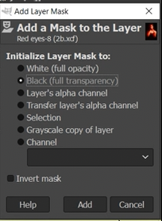

5. Click the black rectangle layer mask that you just created.

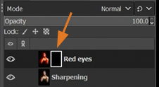

6. Use paintbrush (white color) to paint the parts that you want to reveal (in this example, the eyes).

---

## Selections
* Select: `Tools -> Selection Tools ->`
* Unselect: `shift + ctrl + A`

### Selecting / removing the background

#### Using a 3rd party tool
* Free 3rd party background remover: https://www.adobe.com/products/firefly/features/remove-background.html

#### Using a downscaled image background remover
Sometimes you will use a free background remover tool like https://clipdrop.co/ that will downscale your image. Follow these steps to trace it:

1. Open your original image in Gimp.
2. Paste here the downscaled image (new layer)
3. Scale: `Tools -> Transform Tools -> Scale` or press `shift + S`, then adjust it with the size of the orginal image (you can see the size on the topmost)
4. Long press the **Move tool** to pick the **Alignment tool**, or simply press `Q`
5. Click first the image then click the 2 buttons (see below):

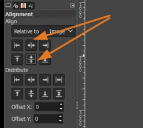

6. Right-click the layer of the downscaled image then select **Alpha to Selection**. Now the background is selected.
7. Click the layer of the original image.
8. Add a layer mask (click the icon on the lower right corner beside the X), then select the **Selection** radio button. Click **Add** button.
9. Now you can hide or delete the layer of the downscaled image.

 

#### Using the Fuzzy Select Tool
The **Fuzzy Select Tool** is used if the object is NOT complex (example: bald person, plain background):
1. Open the **Selection Editor** if not yet opened - `Windows -> Dockable Dialogs -> Selection Editor`
2. Select the **Fuzzy Select Tool** or press `U`
3. On the options, start with **Threshold** around 8 to 12, and make sure the default checked selected radio buttons.

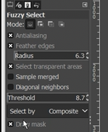

4. Click the background. Hold `shift` to add more selections. Hold `ctrl` to subtract selections (Note: You can use the **Free Select Tool** to get the ones that you want to subtract)
5. Right-click the layer then select **Add Alpha Channel**, then hit `Delete`
6. `shift + ctrl + A` to deselect.

 

#### Using the Foreground Select
The **Foreground Select** is used if the object is complex (example: lot of hair, strands, uneven background):
1. Select the **Foreground Select**.

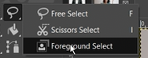

2. Under Options, make sure that **Feather edges** is checked.
3. Draw a selection around the subject, then hit Enter (your cursor will change into a brush)
4. Start painting the subject, you need to be careful and patient here. (Note; If you made a mistake and exceeded, change the **Draw Mode** to **Draw background** then paint the exceeded part)
5. Click the **Preview mask** to see the preview, if you're happy with the selection, click the **Select** button.
6. Add a layer mask (click the icon on the lower right corner beside the X), then select the **Selection** radio button. Click **Add** button. We do this so that we could still edit the selection in the future if needed.
9. `shift + ctrl + A` to deselect.
10. Right-click on the layer mask that you created, then select **Show Layer Mask**

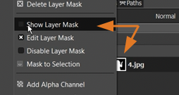

11. Use **Paintbrush Tool** (Mode: Overlay) then paint **black** the imperfections on the background, if there are any. Then paint **white** to the subject's imperfections.

---

## Frequency Separation to Make the Skin Smooth
1. Duplicate the layer: `ctrl + shift + D`
2. `Filters -> Blur -> Gaussian Blur...`
3. Increase the **Size X and Size Y** options just enough to blur the textures. (Note: Don't make the image too blurry)
4. Select this layer (Color and Tone) then change its Mode to **Grain extract**.

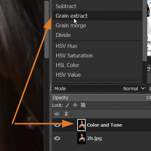

5. Right-click this layer then select **New from Visible** to create a new layer, name it **Texture**
6. Select the **Color and Tone** layer and return its Mode to **Normal**
7. Select the **Texture** layer then change its Mode to **Grain merge**

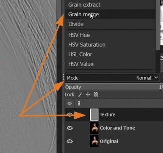

8. Go to the **Color and Tone** layer again. We figure out first which part needs smoothing. Use a selection tool (example: **Free Select**) to select the part needs softening. (Note: In the Tool Options of the Free Select tool, make sure that the **Feather edges** is checked and set to a high value like **50**)
9. `Filters -> Blur -> Gaussian Blur...`, then increase the **Size X and Size Y** options just enough to smoothen the skin.
10. `shift + ctrl + A` to deselect.
11. If you want to soften more parts, select that part by using a selection tool again, then press `ctrl + F` which is a shortcut to repeat the **Gaussian Blur** values. (Note: Don't use `ctrl + F` if you want to input a different Size X & Y values)
12. Create a new **layer group** and put the **Texture** and **Color and Tone** layers in this group. Minimize the folder by clicking the `-`

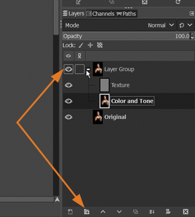

13. Now you can adjust the opacity if you want to lessen the smoothness.

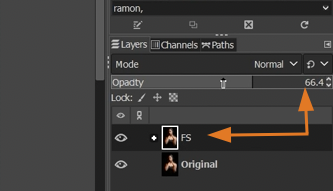

14. If you want to adjust just a part, you could create a **Layer mask -> White**, then paint (lessen the opacty of the paintbrush) the parts with **black**.

---

## How to Merge Different Exposures
We use **exposure blending** to merge pictures with different exposures to get the parts that have correct exposures. This works perfectly with aligned images (photos taken with a tripod).

1. Open the overexposed image.
2. Open the underexposed image.
3. Drag the underexposed image's tab on top of the 1st image (overexposed), so that it will automatically creates a new layer above it. Name this new layer to **underexposed**.

#### Manual Method:

4. Create a layer mask on this **underexposed** layer. (select **black** if you are just getting a small part from the underexposed).
5. Use the **paintbrush tool** then paint **white** all the parts that you want to reveal.

#### Automatic Method:
4. Create a layer mask on this **underexposed** layer. Select **Grayscale copy of layer**. Hit **Add**.
5. Just use the **paintbrush tool** then paint **white** all the parts that you still want to fix.

#### Merging into 1 new layer.
6. If you like the output, right-click this **underexposed** layer then select **New from Visible**.

---

## Changing the Color of the Background
1. Remove your image background using: https://www.pixelcut.ai/background-remover or https://www.adobe.com/products/firefly/features/remove-background.html
2. If you used **pixelcut.ai**, sometimes they change your image's size.
    - Check your image's original size -- right-click your image then select **properties**.
    - In **pixelcut.ai**, before downloading, hit the **Resize** button then input the original size.
3. In Gimp, open the original image.
4. Make the downloaded png a layer -- `File -> Open as Layers...` then select the downloaded png image.
5. Right-click this new layer then select **Alpha to Selection**. You can now hide this layer by clicking the **Eye**

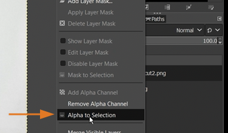

6. Click the original image layer, notice that the subject remains selected. 
7. To select the background -- `Select -> Invert` or press `ctrl + I`
8. Select the foreground color that you want.

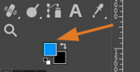

9. Create a new layer.

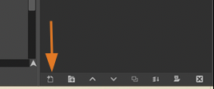

10. Create a new layer mask, choose **Selection**.
11. `ctrl + shift + A` to deselect it.
12. Change the Mode from Normal to **LCh Color** for us to get the shadows from the original image.

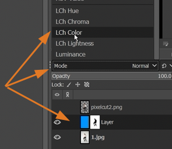

13. Now you can change the background color whenever you want.
    - Change the foreground color.
    - Click the existing color from the layer.

    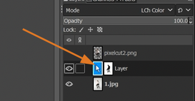

    - `Edit -> Fill with FG Color`

Note: To edit the selection, `alt + click` the layer mask, then use the **paintbrush** tool.

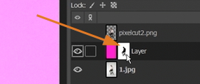